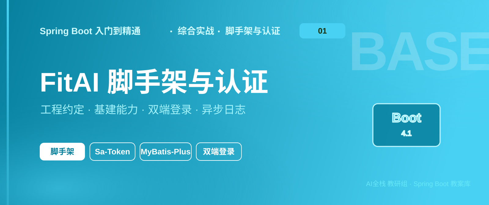
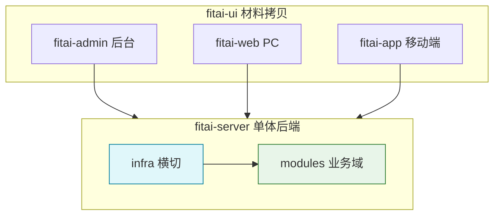
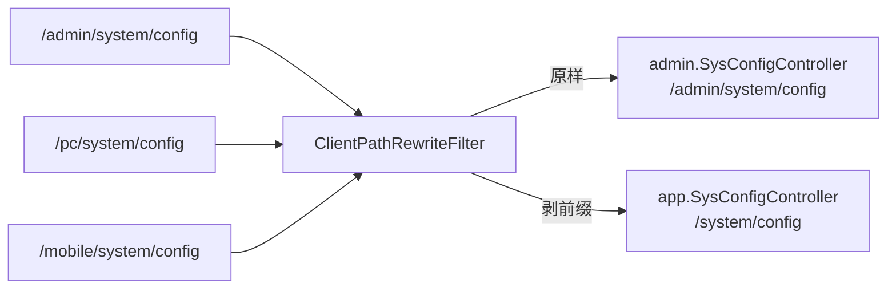
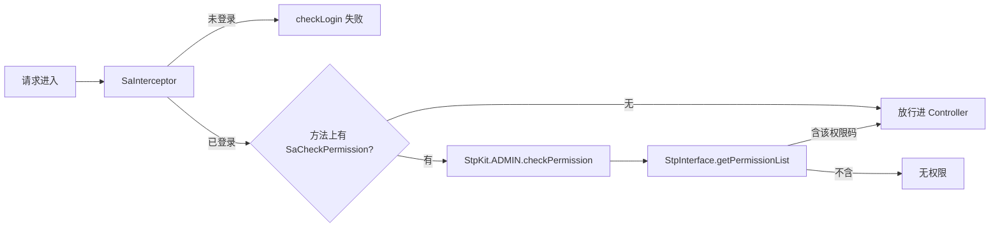
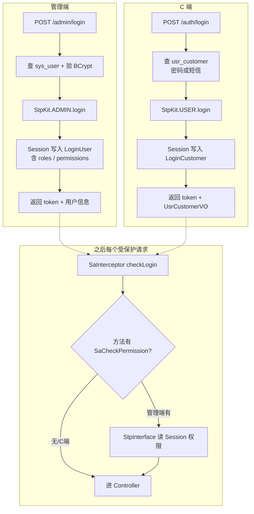
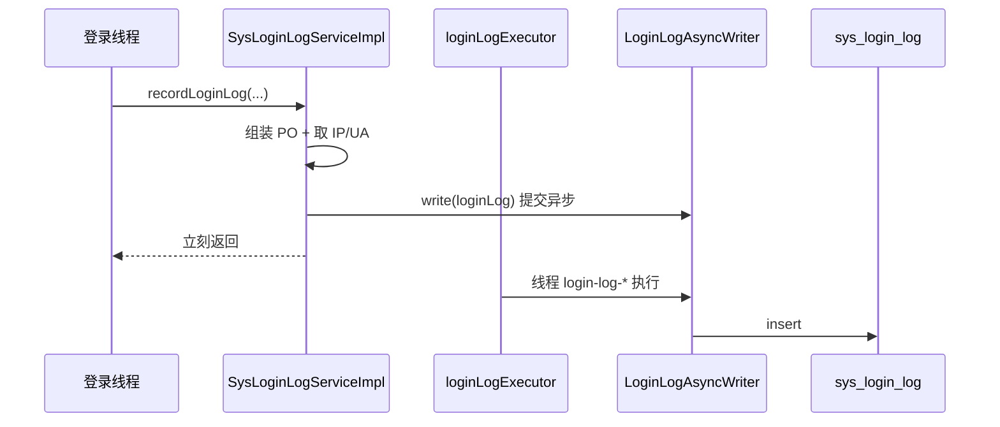
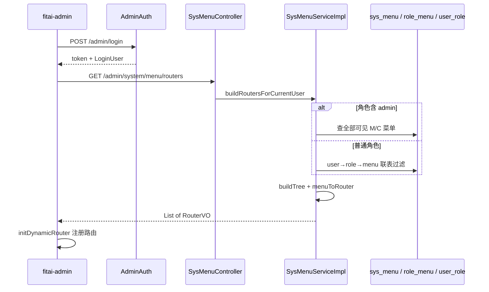

# 《Spring Boot 入门到精通》实战 - FitAI 脚手架与认证

<table class="hero-banner" width="100%" cellspacing="0" cellpadding="0" style="border-collapse:separate;border:none;margin:0 0 4px 0;">
<tr>
<td style="padding:0;border:none;">

</td>
</tr>
</table>
<table class="hero-card" width="100%" cellspacing="0" cellpadding="0" style="border-collapse:separate;border:none;margin:0 0 18px 0;">
<tr>
<td style="padding:0;border:none;">

</td>
</tr>
</table>

> 📖 本章导读
>
> 本专篇是 FitAI 实战的第 02 篇（主笔记）。主线工程为 `prj/fitai-parent`：先搭脚手架与命名约定，再打通双端登录、异步登录日志与管理端动态菜单。后续业务按专篇拆开跟做——系统管理、仪表盘、商品、订单、秒杀、用户等。前端三端从课程材料拷贝至 fitai-ui（admin / app / web），后端按模块化单体从零搭起。技术栈：JDK 21 + Spring Boot 4.1.1 + MyBatis-Plus + Sa-Token + Knife4j。
>
> 系列专篇：见总索引 01 管理端功能；主线：02 脚手架与认证（本篇）→ 03 系统管理 → 04 仪表盘 → 05 商品管理 → 06 订单管理 → 07 秒杀管理 → 08 用户管理 → 09 社区管理 → 10 训练管理 → 11 营销管理 → 12 会员管理。

## 1.1 学习目标

> 💡 学完本篇你将能够
>
> 1、搭出可运行的 Maven 父工程 + 单体后端 + 三端前端同仓结构
>
> 2、用 infra / modules 划分横切能力与业务域，并统一命名约定
>
> 3、落地统一响应、全局异常、错误码分层、MyBatis-Plus、Knife4j 等基建
>
> 4、以 SysConfig 为样板走通 Controller → Service → Mapper → DTO / VO 全链路
>
> 5、用 Filter 剥 /pc、/mobile 前缀，完成三端路径到 admin / app Controller 的映射
>
> 6、在管理端方法上使用 @SaCheckPermission，按“模块:资源:操作”做接口鉴权
>
> 7、打通双端登录闭环：管理端账号密码登录、C 端注册/密码与短信登录，权限从 Session 真正生效
>
> 8、用线程池 + @Async 异步写登录日志（主线程采 Request，避免同类自调用）
>
> 9、落地管理端动态菜单：GET /admin/system/menu/routers 按角色过滤，前端 initDynamicRouter 注册路由
>
> 10、铺齐 sys_* 管理端骨架，为后续专篇加深业务打底
>
> 11、业务加深见专篇：自 03 系统管理 起按总索引跟做（至 12 会员管理）

> 💡 工程知识地图
>


## 1.2 项目定位

FitAI 是智能健身方向的教学向单体项目，覆盖会员、训练、课程、饮食、商城、AI 等业务域。教学目标不是一上来拆微服务，而是：

1、把 Spring Boot 课程能力落到一个真实业务壳里

2、用包级模块化练会边界划分与命名纪律

3、前后端分离：三端 UI 已备好，后端按模块逐步对接

| 项 | 说明 |
| --- | --- |
| 工程路径 | 01_后端/prj/fitai-parent |
| 后端 | fitai-server（Maven 子模块） |
| 前端 | fitai-ui（不进 Maven modules，独立 pnpm / vite 构建） |
| 数据库 | fitai_all（全量脚本见 sql/fitai_all.sql） |

> ⚠️ 前端说明
>
> fitai-ui 下代码从课程材料拷贝而来，目录已对齐为 fitai-admin / fitai-app / fitai-web。材料里可能残留旧品牌痕迹（如默认昵称），对接接口时再逐项清洗。后端命名与包结构以 prj/fitai-parent 为准。

## 1.3 技术栈与环境

| 类别 | 选型 | 版本 / 备注 |
| --- | --- | --- |
| JDK | 21 | 与 Boot 4 配套 |
| Spring Boot | 4.1.1 | spring-boot-starter-webmvc |
| 持久层 | MyBatis-Plus + Join | 3.5.17 / 1.5.9 |
| 认证 | Sa-Token + JWT + Redis | 1.45.0（双端登录闭环见 1.11） |
| 文档 | Knife4j OpenAPI3 | 4.5.0 |
| 工具 | Hutool / Lombok | 5.8.42 |
| 库 | MySQL + Redis | 本地开发默认 root/root、Redis db6 |
| 后台 UI | Vue3 + Element Plus + Vite | fitai-admin |
| PC 端 | Vue3 + Element Plus + Vite | fitai-web |
| 移动端 | uni-app + Vue3 | fitai-app |

## 1.4 工程结构与命名约定

### 1.4.1 顶层目录

```text
fitai-parent/
├── fitai-server/           # 单体后端
├── fitai-ui/
│   ├── fitai-admin/        # 管理后台（材料拷贝）
│   ├── fitai-app/          # 移动端 uni-app（材料拷贝）
│   └── fitai-web/          # PC 用户端（材料拷贝）
├── docs/notes/             # 实战笔记与配图（不进 jar）
├── sql/                    # 全量建库脚本 fitai_all.sql（不进 jar）
├── .gitignore
└── pom.xml                 # 父工程：依赖版本 BOM
```

### 1.4.2 后端包结构

```text
net.wanho.fitai
├── FitaiApplication
├── infra/                      # 横切基础设施
│   ├── auth/                   # Sa-Token
│   ├── async/                  # @EnableAsync + 具名线程池（见 1.12）
│   ├── exception/              # 全局异常 + 通用错误码
│   ├── filter/                 # 多端路径重写等 Servlet Filter
│   ├── knife4j/                # 接口文档
│   ├── mybatis/                 # 分页插件、字段填充
│   ├── page/                   # PageQuery 分页入参基类
│   └── result/                 # AjaxResult 统一响应壳
└── modules/                    # 业务域（包级模块化）
    ├── auth/                   # 双端登录/注册/短信/验证码（见 1.11）
    ├── system/                 # 后台系统（含 async 异步落库组件，见 1.12）
    ├── user/                   # C 端用户 usr_customer（认证最小集）
    ├── member/ ai/ training/ course/ diet/ mall/
    └── coach/ community/ marketing/   # 目录预留，有业务再加类
```

每个业务模块推荐内部形态：

```text
modules/{domain}/
├── controller/
│   ├── admin/              # 管理端：路径 /admin/...
│   └── app/                # 用户端：路径 /...（由 Filter 剥离 /pc、/mobile）
├── service/ + impl/
├── mapper/
├── model/po | dto | vo     # PO 落库；DTO 入参；VO 出参（不含 delFlag/审计字段）
└── code/XxxCode            # 本模块错误码
```

modules.auth 的 Controller 与其它模块一致：controller.admin / controller.app。管理端专用 dto/vo/service 仍放 auth.admin.*；C 端共用 dto/vo/service；短信用 auth.sms 可替换实现。

### 1.4.3 命名铁律

| 类别 | 约定 | 示例 |
| --- | --- | --- |
| 统一响应 | 泛型壳 AjaxResult<T>，放 infra.result | AjaxResult\<SysConfigVO\> |
| 业务异常 | CustomException + ExceptionResult | throw new CustomException(...) |
| 全局 Advice | CatchException | RestControllerAdvice |
| 通用错误码 | CommonCode：标准 200/500 + 1001 起 | 通用 1001 / 认证 1101 / 文件 1201 |
| 业务错误码 | 各模块 XxxCode，千位段 xxx1 起 | System 2001、Member 3001、… |
| DTO | Query / Add / Update | SysConfigAddDTO |
| VO | 对外视图，不含 delFlag / 审计字段 | SysConfigVO |
| 分页查询 | QueryDTO 继承 PageQuery | SysConfigQueryDTO extends PageQuery |
| Service | 接口以 I 结尾 | SysConfigServiceI |
| 路径与类名 | 同词根 | /admin/system/config ↔ SysConfig\* |
| 配置类 | XxxConfig | AuthConfig、Knife4jConfig |
| 配置属性 | XxxProperties | AuthProperties（fitai.auth 白名单） |

### 1.4.4 可执行包与 repackage

Maven 默认 package 打出来的是普通 jar：只有本模块 class，没有依赖，也没有 Spring Boot 启动引导。直接 `java -jar xxx.jar` 会失败（找不到主类或找不到依赖）。

spring-boot-maven-plugin 的 repackage 会在 package 之后再加工一次：

1、把依赖打进同一个“胖 jar”（fat / executable jar）

2、写入 Spring Boot 的 JarLauncher 等启动器，使 Main-Class 指向引导类、真正的业务主类写在 Start-Class

3、部署时一条命令即可：`java -jar fitai-server-1.0.0.jar`

配置写在 `fitai-server/pom.xml`：

```xml
<plugin>
    <groupId>org.springframework.boot</groupId>
    <artifactId>spring-boot-maven-plugin</artifactId>
    <executions>
        <execution>
            <goals>
                <goal>repackage</goal>
            </goals>
        </execution>
    </executions>
</plugin>
```

> 💡 为啥本工程要“显式”写上
>
> 若父 POM 继承了 spring-boot-starter-parent，一般会默认绑定 repackage，子模块只声明 plugin 即可。
>
> 本工程父 POM 用的是自行 import spring-boot-dependencies BOM（没有继承 starter-parent），插件默认绑定不会自动带上，所以必须在子模块里显式加上面的 execution，否则 `mvn package` 得到的仍是普通 jar。
>
> 验收：`mvn -pl fitai-server -DskipTests package` 后，`jar tf target/fitai-server-*.jar | head` 应能看到 BOOT-INF/、org/springframework/boot/loader/；再 `java -jar target/fitai-server-*.jar` 能启动。

## 1.5 脚手架搭建

录课顺序总览（先建立节奏感，细节在各小节展开）：

| 步 | 做什么 | 本节 |
| --- | --- | --- |
| 1 | 创建工程，加入 Spring Boot / MySQL / Lombok / Cache / MyBatis-Plus / Join / Hutool | 1.5.1 |
| 2 | 配置当下 application.yaml（端口、数据源、MP） | 1.5.2 |
| 3 | 加入 Sa-Token + Redis + JWT，再补 yaml | 1.5.3 |
| 4 | SysConfig CRUD 样板 + Knife4j | 1.5.4 |
| 5 | 全局异常，并解决与 Knife4j 的冲突 | 1.5.5 |

### 1.5.1 第 1 步：创建工程并引入基础依赖

目标：能编译的父工程 + 子模块，启动类就绪。本步不写业务、不写 yaml。

1、IDEA 新建 Maven 工程 fitai-parent，packaging 选 pom，JDK 21

2、新建子模块 fitai-server，父工程 modules 只挂这一个

3、前端 fitai-ui 同仓放置，但不进 Maven modules

父 POM 

```xml
<properties>
  <java.version>21</java.version>
  <maven.compiler.release>21</maven.compiler.release>
  <project.build.sourceEncoding>UTF-8</project.build.sourceEncoding>
  <hutool.version>5.8.42</hutool.version>
  <spring-boot.version>4.1.1</spring-boot.version>
  <mybatis-plus.version>3.5.17</mybatis-plus.version>
  <mybatis-plus-join.version>1.5.9</mybatis-plus-join.version>
</properties>

<dependencyManagement>
    <dependencies>
      <!-- mybatis-plus-join -->
      <dependency>
        <groupId>com.github.yulichang</groupId>
        <artifactId>mybatis-plus-join-boot-starter</artifactId>
        <version>${mybatis-plus-join.version}</version>
      </dependency>

      <!-- mybatis-plus -->
      <dependency>
        <groupId>com.baomidou</groupId>
        <artifactId>mybatis-plus-spring-boot4-starter</artifactId>
        <version>${mybatis-plus.version}</version>
      </dependency>

      <!-- mybatis-plus-jsqlparser -->
      <dependency>
        <groupId>com.baomidou</groupId>
        <artifactId>mybatis-plus-jsqlparser</artifactId>
        <version>${mybatis-plus.version}</version>
      </dependency>

      <!-- hutool -->
      <dependency>
        <groupId>cn.hutool</groupId>
        <artifactId>hutool-all</artifactId>
        <version>${hutool.version}</version>
      </dependency>

      <!-- spring-boot-dependencies -->
      <dependency>
        <groupId>org.springframework.boot</groupId>
        <artifactId>spring-boot-dependencies</artifactId>
        <version>${spring-boot.version}</version>
        <type>pom</type>
        <scope>import</scope>
      </dependency>
    </dependencies>
  </dependencyManagement>
```

fitai-server 的pom.xml

```xml
<dependencies>

    <!-- spring-boot-cache -->
    <dependency>
        <groupId>org.springframework.boot</groupId>
        <artifactId>spring-boot-starter-cache</artifactId>
    </dependency>

    <!-- mybatis-plus-join -->
    <dependency>
        <groupId>com.github.yulichang</groupId>
        <artifactId>mybatis-plus-join-boot-starter</artifactId>
    </dependency>

    <!-- mybatis-plus -->
    <dependency>
        <groupId>com.baomidou</groupId>
        <artifactId>mybatis-plus-spring-boot4-starter</artifactId>
    </dependency>

    <!-- mybatis-plus-jsqlparser -->
    <dependency>
        <groupId>com.baomidou</groupId>
        <artifactId>mybatis-plus-jsqlparser</artifactId>
    </dependency>

    <!-- hutool -->
    <dependency>
        <groupId>cn.hutool</groupId>
        <artifactId>hutool-all</artifactId>
    </dependency>

    <!-- spring-boot -->
    <dependency>
        <groupId>org.springframework.boot</groupId>
        <artifactId>spring-boot-starter-webmvc</artifactId>
    </dependency>

    <!-- lombok -->
    <dependency>
        <groupId>org.projectlombok</groupId>
        <artifactId>lombok</artifactId>
        <optional>true</optional>
    </dependency>

    <!-- spring-boot-test -->
    <dependency>
        <groupId>org.springframework.boot</groupId>
        <artifactId>spring-boot-starter-webmvc-test</artifactId>
        <scope>test</scope>
    </dependency>

    <!-- mysql -->
    <dependency>
        <groupId>com.mysql</groupId>
        <artifactId>mysql-connector-j</artifactId>
        <scope>runtime</scope>
    </dependency>
</dependencies>
```

启动类：

```java
@SpringBootApplication
public class FitaiApplication {
    public static void main(String[] args) {
        SpringApplication.run(FitaiApplication.class, args);
    }
}
```

> ✅ 本步验收
>
> Maven 能正常刷新；FitaiApplication 能编译。此时还没有数据源配置，先不要强行连库验证。

### 1.5.2 第 2 步：配置当下 application.yml

application.yml

```yaml
# server
server:
  port: 8080

# spring
spring:
  application:
    name: fitai-server
  datasource:
    driver-class-name: com.mysql.cj.jdbc.Driver
    url: jdbc:mysql://localhost:3306/fitai_all?serverTimezone=Asia/Shanghai&useUnicode=true&characterEncoding=utf-8&allowPublicKeyRetrieval=true
    username: root
    password: root

# mybatis-plus
mybatis-plus:
  type-aliases-package: net.wanho.fitai.modules.*.model.po
  mapper-locations: classpath*:mapper/**/*.xml
  configuration:
    map-underscore-to-camel-case: true
    log-impl: org.apache.ibatis.logging.stdout.StdOutImpl
  global-config:
    db-config:
      id-type: auto
      logic-delete-field: delFlag
      logic-delete-value: 2
      logic-not-delete-value: 0
```

net.wanho.fiai.infra.mybatis包上加上 MP 基建两个类


config/MybatisPlusConfig.java

```java
@Configuration
@MapperScan("net.wanho.fitai.modules.*.mapper")
public class MybatisPlusConfig {
    /**
     * 添加分页插件
     */
    @Bean
    public MybatisPlusInterceptor mybatisPlusInterceptor() {
        MybatisPlusInterceptor interceptor = new MybatisPlusInterceptor();
        interceptor.addInnerInterceptor(new PaginationInnerInterceptor(DbType.MYSQL)); 
        interceptor.addInnerInterceptor(new OptimisticLockerInnerInterceptor());
        return interceptor;
    }
}
```

config/MyMetaObjectHandler.java

```java
@Component
public class MyMetaObjectHandler implements MetaObjectHandler {

    @Override
    public void insertFill(MetaObject metaObject) {
        //todo登录后完善
        this.strictInsertFill(metaObject, "createBy", String.class, "admin");
        this.strictInsertFill(metaObject, "createTime", LocalDateTime.class, LocalDateTime.now());
    }

    @Override
    public void updateFill(MetaObject metaObject) {
        //todo登录后完善
        this.strictInsertFill(metaObject, "updateBy", String.class, "admin");
        this.strictUpdateFill(metaObject, "updateTime", LocalDateTime.class, LocalDateTime.now());
    }
}
```

> ✅ 本步验收
>
> 本地建好库 fitai_all（可先空库）；启动 FitaiApplication，能起来且不再报数据源缺失。表结构和 SysConfig 接口下一步再做。

### 1.5.3 第 3 步：接入 Sa-Token + Redis + JWT

目标：认证相关依赖与配置就位；拦截器先占位，登录接口未写前不要打开全站鉴权。

1、父 POM

```xml
<dependencyManagement>
    <dependencies>

      <!-- Sa-Token 整合 jwt -->
      <dependency>
        <groupId>cn.dev33</groupId>
        <artifactId>sa-token-jwt</artifactId>
        <version>${sa-token.version}</version>
      </dependency>

      <!-- Sa-Token 整合 RedisTemplate -->
      <dependency>
        <groupId>cn.dev33</groupId>
        <artifactId>sa-token-redis-template</artifactId>
        <version>${sa-token.version}</version>
      </dependency>

      <!-- Sa-Token -->
      <dependency>
        <groupId>cn.dev33</groupId>
        <artifactId>sa-token-spring-boot4-starter</artifactId>
        <version>${sa-token.version}</version>
      </dependency>
        
    </dependencies>
</dependencyManagement>
```

2、子模块中POM

在 application.yaml 末尾追加

```yaml
spring:
  data:
    redis:
      host: localhost
      port: 6379
      password:
      database: 6

# Sa-Token
sa-token:
  token-name: satoken
  timeout: 2592000
  active-timeout: -1
  is-concurrent: true
  is-share: false
  token-style: uuid
  is-log: true
  jwt-secret-key: asdasdasifhueuiwyurfewbfjsdafjk
  is-print: false

# 鉴权白名单（AuthConfig / SaRouter.notMatch）——新增公开接口只改这里，勿写死在 Java
fitai:
  auth:
    # 管理端：匹配 /admin/** 时排除
    admin-ignore-urls:
      - /admin/login
    # 用户端：匹配 /** 时排除（含管理端前缀、公开接口、文档）
    user-ignore-urls:
      - /admin/**
      - /auth/login
      - /auth/register
      - /auth/sms/send
      - /auth/captcha/enabled
      - /captcha/**
      - /doc.html
      - /swagger-ui/**
      - /v3/api-docs/**
      - /webjars/**
      - /favicon.ico
      - /error
```

sat-token基建类


#### 1.5.3.1 设计重点：为啥要 StpKit + yaml 白名单

这两处不是“顺手封装”，而是后面登录闭环、双端并行时的地基。抄作业时先吃透“为什么”，再贴代码。

1）StpKit：双端会话必须物理隔离，[官网](https://sa-token.cc/doc.html#/up/many-account?id=%e5%a4%9a%e8%b4%a6%e5%8f%b7%e8%ae%a4%e8%af%81)

| 问题 | 只用默认 StpUtil | 用 StpKit.ADMIN / StpKit.USER |
| --- | --- | --- |
| 主键撞车 | sys_user.user_id=1 与 usr_customer.customer_id=1 会被当成同一登录态 | 不同 loginType（admin / user），会话、token 空间分开 |
| 登出/踢人 | 一端 logout 可能波及另一端 | 各踢各的，互不影响 |
| 权限注解 | @SaCheckPermission 默认走 StpUtil | 把 StpKit.ADMIN 注册成默认 StpLogic Bean，管理端注解无需改写法；C 端不走菜单权限 |

定稿形态（路径：infra.auth.helper.StpKit）：

```java
public final class StpKit {
    /** 管理端；同时作为 StpUtil 默认逻辑，供 @SaCheckPermission 使用 */
    public static final StpLogic ADMIN = new StpLogicJwtForSimple("admin");
    /** C 端 */
    public static final StpLogic USER = new StpLogicJwtForSimple("user");
    private StpKit() {}
}
```

记忆口诀：loginId 可以重复，loginType 不能混。 登录/校验一律写 StpKit.ADMIN.xxx / StpKit.USER.xxx，业务里不要再直接用裸 StpUtil（注解底层仍走默认 ADMIN，这是刻意的）。

1.1）@SaCheckPermission：Admin / User 怎么用（别混）

AuthConfig 把 StpKit.ADMIN 注册成默认 StpLogic 后，不写 type 的注解一律走 admin。这和“路由 checkLogin 按路径分流”是两回事——登录门禁看 URL，方法权限注解看 type（默认 = admin）。

| 维度 | Admin（管理端） | User（C 端） |
| --- | --- | --- |
| 登录 API | StpKit.ADMIN.login(userId) | StpKit.USER.login(customerId) |
| 会话缓存 | AdminLoginHelper + LoginUser（含 roles/permissions） | UserLoginHelper + LoginCustomer（无菜单权限字段） |
| 权限体系 | 有：角色 → 菜单 perms | 本工程没有后台那套菜单权限 |
| @SaCheckPermission | 直接写权限码即可 | 默认不要挂；若误挂且不写 type，会去校验 admin 会话 |
| StpInterface | loginType=admin 时从 Session 读权限列表 | 非 admin 直接返回空列表 |

管理端（推荐写法，与现有 SysConfigController 一致）：

```java
// 默认 type="" → 走已注册的 StpKit.ADMIN，校验 LoginUser.permissions
@SaCheckPermission("system:config:delete")
public AjaxResult<Void> delete(...) { ... }

// 等价显式写法（一般不必写）
@SaCheckPermission(value = "system:config:delete", type = "admin")
```

C 端：

```java
// ✅ 常规：只靠路由 StpKit.USER.checkLogin()，方法上不挂菜单权限注解
@GetMapping("/profile")
public AjaxResult<UsrCustomerVO> profile() { ... }

// ❌ 错误：没写 type，注解去查 admin 是否登录/是否有该权限码 → C 端用户必挂
@SaCheckPermission("system:config:list")
public AjaxResult<?> bad() { ... }

// ⚠️ 仅当业务真要给 C 端做“权限码”时才用；且必须指定 type = "user"
// 同时 StpInterface 要对 loginType=user 返回权限列表（本工程未做，勿抄半截）
@SaCheckPermission(value = "order:pay", type = "user")
public AjaxResult<?> pay() { ... }
```

一句话：Admin 用注解卡操作权；User 默认只卡登录。 完整约定与验收见 [1.8](#18-方法级权限sacheckpermission)。

2）yaml 白名单：免登录路径是配置，不是代码

| 问题 | 写死在 AuthConfig.notMatch(...) | 抽到 fitai.auth.*-ignore-urls |
| --- | --- | --- |
| 加公开接口 | 改 Java → 重编译 → 发版 | 改 yaml（或环境差异配置）即可 |
| 环境差异 | 开发要放行 /doc.html，生产要关，难切 | application-dev.yml / prod 各自维护 |
| 双端规则 | 一长串字符串挤在拦截器里，难读易漏 | 拆成两份列表，和两条 SaRouter 规则一一对应 |

两份名单各自对应一条路由链，别合成一个“大杂烩”：

```text
/admin/**  + admin-ignore-urls  →  StpKit.ADMIN.checkLogin()
/**        + user-ignore-urls   →  StpKit.USER.checkLogin()
```

user-ignore-urls 里必须带 /admin/：否则“用户端 match /”会把管理端请求也拦进 USER.checkLogin()，管理员有 admin token 却过不了 user 校验。管理端自己的登录页放 admin-ignore-urls（如 /admin/login）。

AuthProperties.java（路径：infra.auth.config）

```java
@Data
@ConfigurationProperties(prefix = "fitai.auth")
public class AuthProperties {

    /** 管理端免登录路径（匹配 /admin/** 时排除） */
    private List<String> adminIgnoreUrls = new ArrayList<>();

    /** 用户端免登录路径（匹配 /** 时排除） */
    private List<String> userIgnoreUrls = new ArrayList<>();
}
```

AuthConfig.java

```java
@Configuration
@EnableConfigurationProperties(AuthProperties.class)
@RequiredArgsConstructor
public class AuthConfig implements WebMvcConfigurer {

    private final AuthProperties authProperties;

    /** 注册 JWT 风格 StpLogic，并作为 StpUtil 默认逻辑（管理端） */
    @Bean
    public StpLogic getStpLogicJwt() {
        return StpKit.ADMIN;
    }

    @Override
    public void addInterceptors(InterceptorRegistry registry) {
        registry.addInterceptor(new SaInterceptor(handler -> {
            // 管理端
            SaRouter.match("/admin/**")
                    .notMatch(authProperties.getAdminIgnoreUrls())
                    .check(r -> StpKit.ADMIN.checkLogin());

            // 用户端（排除公开接口与文档）
            SaRouter.match("/**")
                    .notMatch(authProperties.getUserIgnoreUrls())
                    .check(r -> StpKit.USER.checkLogin());
        })).addPathPatterns("/**");
    }
}
```

约定：免登录路径只维护在 fitai.auth.*-ignore-urls；SaRouter.notMatch 支持 List<String>，直接传入即可。

StpInterfaceImpl.java

```java
@Service
public class StpInterfaceImpl implements StpInterface {
    @Override
    public List<String> getPermissionList(Object loginId, String loginType) {
        return List.of();
    }

    @Override
    public List<String> getRoleList(Object loginId, String loginType) {
        return List.of();
    }
}

```

> ✅ 本步验收
>
> Redis 已启动；项目能启动；脚手架阶段可将 AuthConfig 的 @Configuration 暂时注释（登录未写时不要全站鉴权）。登录闭环见 [1.11](#111-登录闭环双端认证落地)：打开 AuthConfig、写登录接口、实现 StpInterface 后，@SaCheckPermission 才真正生效。新增公开接口时只改 yaml 白名单，不必动 Java。

### 1.5.4 第 4 步：SysConfig CRUD + Knife4j

目标：走通第一条业务样板，并用 Knife4j 可视化调试。本步仍不做全局异常。

#### 1.5.4.1 依赖与文档配置

1、父 POM 

```xml
<dependencyManagement>
    <dependencies>

      <!-- knife4j -->
      <dependency>
        <groupId>com.github.xiaoymin</groupId>
        <artifactId>knife4j-openapi3-jakarta-spring-boot-starter</artifactId>
        <version>${knife4j.version}</version>
      </dependency>
    </dependencies>
    
</dependencyManagement>
```

2、fitai-server 引入该 starter

3、application.yaml 追加：

```yaml
# knife4j
knife4j:
  enable: true
  basic:
    enable: true
    username: admin
    password: admin
  production: false
```

4、编写 infra.knife4j.config.Knife4jConfig：OpenAPI 标题/联系人 + GroupedOpenApi 分组（管理端至少先做“后台管理”pathsToMatch("/admin/")；用户端可预留 /system/ 等）

#### 1.5.4.2 统一响应与分页基类

先放两个横切小类，Controller 才能统一返回：

1、infra.result.AjaxResult\<T\>：强类型字段 success / code / msg / data
   - 成功：code = 200
   - 失败：无参或仅 msg 时默认 code = 500；也可传入业务错误码（如 400、1104）

2、infra.page.PageQuery：pageNum 默认 1，pageSize 默认 10；后续所有 XxxQueryDTO 继承它

约定：列表路径统一 /list，方法只收一个 queryDto，不要再拆 pageNum、pageSize 两个 RequestParam。

##### 1.5.4.2.1 为啥 AjaxResult 要带泛型

早期写法常见是 AjaxResult extends HashMap<String, Object>：put("data", xxx) 随手塞，编译期看不出 data 里到底是什么。带上泛型后变成 AjaxResult<T>，data 的类型在方法签名上写死：

| 写法 | 含义 |
| --- | --- |
| AjaxResult<IPage<SysConfigVO>> | 分页列表，元素是 VO |
| AjaxResult<SysConfigVO> | 单条配置 |
| AjaxResult<String> | 按 key 取配置值 |
| AjaxResult<Void> | 增删改成功，无业务体 |

好处有三点：

1、可读：打开 Controller 就知道接口返回什么，不用猜 HashMap 里塞了啥

2、可校验：IDE / 编译器能拦住“把 PO 页塞进 AjaxResult<IPage<SysConfigVO>>”这类错误

3、文档更准：Knife4j / springdoc 能根据 T 展开 data 的字段结构，而不是一团 object

定稿代码（infra.result.AjaxResult）：

```java
package net.wanho.fitai.infra.result;

import io.swagger.v3.oas.annotations.media.Schema;
import lombok.AllArgsConstructor;
import lombok.Data;
import lombok.NoArgsConstructor;

import java.io.Serializable;

/**
 * 统一 API 响应壳。
 * <p>
 * 成功时 code 为 200；失败时默认 code 为 500，也可传入业务错误码。
 *
 * @param <T> 业务数据类型
 */
@Data
@NoArgsConstructor
@AllArgsConstructor
@Schema(description = "统一响应结果")
public class AjaxResult<T> implements Serializable {

    @Schema(description = "是否成功")
    private boolean success;

    @Schema(description = "业务状态码", example = "200")
    private int code;

    @Schema(description = "提示信息")
    private String msg;

    @Schema(description = "业务数据")
    private T data;

    /** 成功（无数据） */
    public static <T> AjaxResult<T> success() {
        return new AjaxResult<>(true, 200, "操作成功", null);
    }

    /** 成功（带数据） */
    public static <T> AjaxResult<T> success(T data) {
        return new AjaxResult<>(true, 200, "操作成功", data);
    }

    /** 失败（默认码 500） */
    public static <T> AjaxResult<T> error() {
        return new AjaxResult<>(false, 500, "操作失败", null);
    }

    /** 失败（默认码 500，自定义消息） */
    public static <T> AjaxResult<T> error(String msg) {
        return new AjaxResult<>(false, 500, msg, null);
    }

    /** 失败（默认码 500，自定义消息与数据） */
    public static <T> AjaxResult<T> error(String msg, T data) {
        return new AjaxResult<>(false, 500, msg, data);
    }

    /** 失败（自定义业务码与消息） */
    public static <T> AjaxResult<T> error(int code, String msg) {
        return new AjaxResult<>(false, code, msg, null);
    }

    /** 失败（自定义业务码、消息与数据） */
    public static <T> AjaxResult<T> error(int code, String msg, T data) {
        return new AjaxResult<>(false, code, msg, data);
    }

    /** 失败（自定义业务码与数据，消息固定为“操作失败”） */
    public static <T> AjaxResult<T> error(int code, T data) {
        return new AjaxResult<>(false, code, "操作失败", data);
    }
}
```

#### 1.5.4.3 SysConfig 分层落地

包路径：modules.system

| 层 | 类 | 要点 |
| --- | --- | --- |
| PO | SysConfig | 落库实体；含 delFlag、create*/update*（FieldFill） |
| VO | SysConfigVO | 对外视图；不含 delFlag 与审计字段；@AutoMapper(target = SysConfig.class) |
| Mapper | SysConfigMapper | 继承 MPJBaseMapper\<SysConfig\>；类上一行职责注释即可 |
| Service | SysConfigServiceI | 继承 MPJBaseService\<SysConfig\>；查询方法返回 VO |
| ServiceImpl | SysConfigServiceImpl | 分页用 LambdaQueryWrapper；page.convert + Converter → VO |
| DTO | Query / Add / Update | QueryDTO extends PageQuery |
| Controller | admin.SysConfigController | /admin/system/config；返回 AjaxResult<...>；@Tag + @Operation + @SaCheckPermission |

##### 1.5.4.3.1 为啥接口返回 VO，不直接返回 PO

PO（SysConfig）是给持久层用的：带 delFlag、createBy、createTime、updateBy、updateTime 等内部字段。Controller 若直接 AjaxResult.success(po)，会把这些字段一并序列化给前端。

| 直接返回 PO 的问题 | 用 VO 的解法 |
| --- | --- |
| 泄露逻辑删除标志、操作人等内部元数据 | VO 只保留前端真正需要的业务字段 |
| 表结构一改，接口契约跟着抖 | 对外契约挂在 VO 上，PO 可独立演进 |
| Knife4j 文档里出现一堆无关字段 | @Schema 写在 VO 上，文档更干净 |
| 前后端耦合“库表长什么样” | 入参 DTO、出参 VO、落库 PO 各司其职 |

约定：

1、入参用 DTO（Query / Add / Update）

2、出参用 VO（如 SysConfigVO）

3、落库 / Mapper 只用 PO；Service 查完 PO 再 converter.convert(..., SysConfigVO.class) 再往上抛

SysConfig 样板里 VO 不含 delFlag 与审计字段，验收时看分页 data.records 即可核对。

Controller 定稿（管理端，完整代码见工程）：

```java
/**
 * 系统配置管理（管理端）。
 * 查询接口统一返回 SysConfigVO，不暴露逻辑删除与审计字段。
 */
@RestController
@RequestMapping("/admin/system/config")
@RequiredArgsConstructor
@Tag(name = "系统配置管理")
public class SysConfigController {

    private final SysConfigServiceI sysConfigService;

    @GetMapping("/list")
    @Operation(summary = "分页查询配置")
    @SaCheckPermission("system:config:list")
    public AjaxResult<IPage<SysConfigVO>> findByPage(SysConfigQueryDTO queryDto) {
        return AjaxResult.success(sysConfigService.findByPage(queryDto));
    }

    // GET /{configId} → AjaxResult<SysConfigVO> + system:config:list
    // GET /key/{configKey} → AjaxResult<String>（暂不挂权限）
    // POST / PUT → AjaxResult<Void> + add / update
    // DELETE /{configIds} → AjaxResult<Void> + delete（List<Long>，支持 1,2）
}
```

要点：

1、路径变量与领域字段对齐：configId / configKey / configIds

2、删除用 @PathVariable List<Long> configIds：DELETE .../1,2 时 Spring 转成列表，Service removeByIds（逻辑删除）

3、权限码 system:config:{list|add|update|delete}，详见 1.8；AuthConfig 仍注释时注解尚未真正拦截

Service 分页要点（查库用 PO，出参转 VO）：

```java
IPage<SysConfig> page = new Page<>(queryDto.getPageNum(), queryDto.getPageSize());
LambdaQueryWrapper<SysConfig> wrapper = new LambdaQueryWrapper<>();
wrapper.like(StrUtil.isNotEmpty(queryDto.getConfigName()),
        SysConfig::getConfigName, queryDto.getConfigName());
// configKey、status 同理
IPage<SysConfig> result = this.page(page, wrapper);
return result.convert(item -> converter.convert(item, SysConfigVO.class));
```

新增/修改本步可先用 Hutool BeanUtil.copyProperties（1.6.2 再换成 MapStruct Plus）。查询侧定稿后统一走 Converter → VO。

> ⚠️ 库表
>
> 调试前确认 fitai_all 中已有 sys_config 表（全量脚本见仓库根目录 `sql/fitai_all.sql`，有则执行）。

> ✅ 本步验收
>
> 启动后访问 Knife4j（basic 账号 admin/admin），在“后台管理”分组调通 GET /admin/system/config/list，响应 data.records 中无 delFlag / createBy 等审计字段。本步 AuthConfig 仍注释，故 @SaCheckPermission 尚未拦截；此时还没有全局异常——故意留到下一步。

### 1.5.5 第 5 步：全局异常，解决与 Knife4j 的冲突

目标：业务异常统一收口为 AjaxResult；同时避免全局 Advice 被 Knife4j 扫进文档。

#### 1.5.5.1 为什么单独一步

第 4 步先把 CRUD 跑通，学生脑子里只有“接口怎么写”。本步再引入：

1、错误码契约 ExceptionResult

2、通用码 CommonCode（标准 200/500 + 1001 起；业务码进各模块 XxxCode）

3、CustomException 携带 ExceptionResult

4、CatchException（@RestControllerAdvice）转 AjaxResult

抛错写法：

```java
throw new CustomException(CommonCode.DATA_NOT_FOUND);
// 业务模块示例：
// throw new CustomException(MallCode.STOCK_NOT_ENOUGH);
```

CatchException：

```java
@RestControllerAdvice
@Hidden
public class CatchException {

    @ExceptionHandler(CustomException.class)
    public AjaxResult<Void> catchCustomException(CustomException e) {
        ExceptionResult result = e.getExceptionResult();
        return AjaxResult.error(result.code(), result.msg());
    }

    @ExceptionHandler(Exception.class)
    public AjaxResult<Void> catchException(Exception e) {
        // 默认 code=500
        return AjaxResult.error(e.getMessage());
    }
}
```

#### 1.5.5.2 与 Knife4j 的冲突与处理

| 现象 | 原因 | 处理 |
| --- | --- | --- |
| 文档里冒出 catchCustomException 等方法 | Knife4j / springdoc 会扫描 @RestControllerAdvice 上的 @ExceptionHandler，当成接口 | 在 CatchException 类上加 @Hidden（io.swagger.v3.oas.annotations.Hidden） |
| 文档分组脏、路径怪异 | 同上 | 加 @Hidden 后刷新文档即可 |

> 💡 教学提示
>
> 课堂上可先故意不加 @Hidden，打开 Knife4j 让学生看到“异常处理方法进文档”，再补注解——印象更深。

错误码号段（勿把业务码塞回 CommonCode）：

| 枚举 | 号段 | 说明 |
| --- | --- | --- |
| CommonCode | 200 / 500；1001+ | 标准码；通用 1001、认证 1101、文件 1201 |
| SystemCode | 2001-2999 | 系统模块 |
| MemberCode | 3001-3999 | 会员 |
| TrainingCode | 4001-4999 | 训练 |
| CourseCode | 5001-5999 | 课程 |
| MallCode | 6001-6999 | 商城 |
| DietCode | 7001-7999 | 饮食 |
| AiCode | 8001-8999 | AI |

> ✅ 本步验收
>
> 在任意接口里临时 throw new CustomException(CommonCode.PARAM_ERROR)，响应体为统一 AjaxResult；Knife4j 文档中不再出现 CatchException 的处理方法。

### 1.5.6 脚手架收尾

> 💡 本节作用
>
> 对照 1.5.1–1.5.5 做总验收：能启动、能开文档、能打通 SysConfig。已完成项与下一阶段分开写，避免把“还没做的业务”和“脚手架交付物”混在一张勾选表里。

#### 1.5.6.1 已完成交付物

| 步 | 交付物 | 小节 |
| --- | --- | --- |
| 1 | 父 POM + fitai-server + 基础依赖 + FitaiApplication | 1.5.1 |
| 2 | application.yaml（端口 / 数据源 / MP）+ MybatisPlusConfig、MyMetaObjectHandler | 1.5.2 |
| 3 | Sa-Token + Redis + JWT 依赖与 yaml；fitai.auth 白名单 + AuthConfig 占位（脚手架阶段可注释 @Configuration） | 1.5.3 |
| 4 | AjaxResult\<T\>、PageQuery、SysConfig CRUD（含 VO）、Knife4j | 1.5.4 |
| 5 | 错误码号段（Common 1001 / System 2001 / 业务 3001 起）+ CatchException（含 @Hidden） | 1.5.5 |

## 1.6 校验与对象映射

### 1.6.1 Bean Validation

> 💡 为啥单独一节
>
> 第 4 步只求把 SysConfig CRUD 跑通，入参合法性还靠“人眼 + 数据库约束”。业务一多，散落 if 判空既丑又漏。

1、fitai-server 引入：

```xml
<dependency>
    <groupId>org.springframework.boot</groupId>
    <artifactId>spring-boot-starter-validation</artifactId>
</dependency>
```

2、DTO 上声明约束（message 写给人看的中文）：

```java
@Data
@Schema(description = "新增系统配置参数")
@AutoMapper(target = SysConfig.class)  // 映射见 1.6.2
public class SysConfigAddDTO implements Serializable {
    @NotBlank(message = "系统配置名称不能为空")
    private String configName;
    @NotBlank(message = "系统配置键不能为空")
    private String configKey;
    // configValue / configType / status 同理；remark 可空
}
```

UpdateDTO 至少保证主键：

```java
@NotNull(message = "参数ID不能为空")
private Long configId;
```

3、Controller 入参加 @Valid（缺它注解不生效）：

```java
@PostMapping
public AjaxResult<Void> add(@Valid @RequestBody SysConfigAddDTO addDto) { ... }

@PutMapping
public AjaxResult<Void> update(@Valid @RequestBody SysConfigUpdateDTO updateDto) { ... }
```

4、CatchException 增加校验异常收口，避免把 MethodArgumentNotValidException 堆栈甩给前端：

```java
@ExceptionHandler(MethodArgumentNotValidException.class)
public AjaxResult<Void> handleBody(MethodArgumentNotValidException ex) {
    String msg = ex.getBindingResult().getFieldErrors().stream()
            .map(FieldError::getDefaultMessage)
            .collect(Collectors.joining("; "));
    return AjaxResult.error(400, msg);
}
```

> ✅ 本步验收
>
> Knife4j 里 POST /admin/system/config 故意不传 configKey，业务码 400，msg 为“系统配置键不能为空”（多字段用分号拼接）。

### 1.6.2 MapStruct Plus（替代 BeanUtil）

> 💡 为啥换方案
>
> 1.5.4 用 Hutool BeanUtil.copyProperties 是为了最快打通 DTO → PO。它够用，但有三处短板：运行时反射、字段改名/类型不一致编译期发现不了、嵌套与树形 VO 后面会很别扭。

1、父 POM

properties 追加版本号；dependencyManagement 追加：

```xml
<properties>
  <!-- 既有版本略 -->
  <mapstruct-plus.version>1.5.0</mapstruct-plus.version>
  <lombok.version>1.18.46</lombok.version>
  <lombok-mapstruct-binding.version>0.2.0</lombok-mapstruct-binding.version>
</properties>

<dependencyManagement>
    <dependencies>

      <!-- mapstruct-plus -->
      <dependency>
        <groupId>io.github.linpeilie</groupId>
        <artifactId>mapstruct-plus-spring-boot-starter</artifactId>
        <version>${mapstruct-plus.version}</version>
      </dependency>

    </dependencies>
</dependencyManagement>
```

2、fitai-server 引入 starter

```xml
<dependencies>

    <!-- mapstruct-plus -->
    <dependency>
        <groupId>io.github.linpeilie</groupId>
        <artifactId>mapstruct-plus-spring-boot-starter</artifactId>
    </dependency>

</dependencies>
```

3、DTO / VO 声明映射目标：

```java
@AutoMapper(target = SysConfig.class)
public class SysConfigAddDTO implements Serializable { ... }

@AutoMapper(target = SysConfig.class)
public class SysConfigVO implements Serializable { ... }  // 出参，字段少于 PO
```

4、Service 注入 io.github.linpeilie.Converter：

```java
private final Converter converter;

public void add(SysConfigAddDTO addDto) {
    SysConfig sysConfig = converter.convert(addDto, SysConfig.class);
    this.save(sysConfig);
}

public SysConfigVO findById(Long configId) {
    return converter.convert(this.getById(configId), SysConfigVO.class);
}
```

> ⚠️ 与 Lombok 的冲突（必配）
>
> MapStruct Plus 与 Lombok 都是注解处理器。若编译期 Lombok 还没生成 getter/setter，MapStruct 就会认为“没有属性可映射”，轻则转换结果全 null，重则编译失败。
>
> 解法：在 maven-compiler-plugin 顶层 configuration.annotationProcessorPaths 里固定顺序，并加上桥接包（不要再拆一套 default-compile / default-testCompile 的重复 execution）：
>
> 1、lombok
>
> 2、mapstruct-plus-processor
>
> 3、lombok-mapstruct-binding
>
> 版本号与 mapstruct-plus 一样放在父 POM properties，annotationProcessorPaths 用属性引用。同时建议 <proc>full</proc>。IDEA 本地也要启用 Annotation Processors。

关键片段（fitai-server/pom.xml）：

```xml
<plugin>
    <groupId>org.apache.maven.plugins</groupId>
    <artifactId>maven-compiler-plugin</artifactId>
    <configuration>
        <proc>full</proc>
        <annotationProcessorPaths>
            <path>
                <groupId>org.projectlombok</groupId>
                <artifactId>lombok</artifactId>
                <version>${lombok.version}</version>
            </path>
            <path>
                <groupId>io.github.linpeilie</groupId>
                <artifactId>mapstruct-plus-processor</artifactId>
                <version>${mapstruct-plus.version}</version>
            </path>
            <path>
                <groupId>org.projectlombok</groupId>
                <artifactId>lombok-mapstruct-binding</artifactId>
                <version>${lombok-mapstruct-binding.version}</version>
            </path>
        </annotationProcessorPaths>
    </configuration>
</plugin>

<!-- 可执行 jar：显式 repackage，说明见 1.4.4 -->
<plugin>
    <groupId>org.springframework.boot</groupId>
    <artifactId>spring-boot-maven-plugin</artifactId>
    <executions>
        <execution>
            <goals>
                <goal>repackage</goal>
            </goals>
        </execution>
    </executions>
</plugin>
```

> 💡 repackage 的作用、以及为何本工程要显式写 execution，见 1.4.4。

> ✅ 本步验收
>
> 1、mvn -pl fitai-server compile 无报错，target/generated-sources 下能看到 MapStruct Plus 生成的转换类（含 SysConfig ↔ SysConfigVO）
>
> 2、调用新增接口后库表字段与 DTO 一致（不是全 null）
>
> 3、单测可对比：同一份 SysConfigAddDTO，converter.convert 与 BeanUtil.copyProperties 结果字段对齐（工程里 FitaiApplicationTests#test1 可作对照）

## 1.7 多端路径重写（Filter）

> 📖 本节导读
>
> 前端三端（admin / web / app）对外 URL 前缀不同，但用户端后端只想维护一套 /xxx 接口。本节用最高优先级的 OncePerRequestFilter，在进入 DispatcherServlet 之前把 /pc、/mobile 剥掉，管理端 /admin 原样放行。

### 1.7.1 问题与约定

背景有两点：

1、管理端接口以 /admin 开头；用户端业务接口本可以一律以 / 开头

2、为了区分客户端来源（PC / 移动端），前端约定再挂一层前缀：/pc、/mobile；真正落到 Controller 上的路径仍是 /xxx

因此对外可见的三种前缀与后端映射关系如下：

| 客户端 | 前端请求路径 | Filter 重写后 | Controller |
| --- | --- | --- | --- |
| 管理后台 | /admin/system/config/... | 不变 | controller.admin → /admin/system/config |
| PC 用户端 | /pc/system/config/... | /system/config/... | controller.app → /system/config（可按需再加） |
| 移动端 | /mobile/system/config/... | /system/config/... | 同上 |



> 💡 为什么不用两套用户端 Controller
>
> /pc 与 /mobile 只是来源标记，业务处理相同。若为每个前缀各写一套 @RequestMapping，接口会翻倍且易漂移。Filter 剥前缀后，用户端只保留一套 controller.app。

### 1.7.2 Controller 按端拆包

同一业务、两套入口。类名可相同，但 Spring bean 名必须不同（否则启动冲突）。当前样板以管理端为准；用户端 Controller 可按业务再补：

```java
// modules.system.controller.admin（当前已落地）
@RestController
@RequestMapping("/admin/system/config")
@Tag(name = "系统配置管理")
public class SysConfigController { ... }

// modules.system.controller.app（用户端，按需）
@RestController("AppSysConfigController")
@RequestMapping("/system/config")
@Tag(name = "系统配置（用户端）")
public class SysConfigController { ... }
```

约定：

1、@Operation 文案带业务语义；返回 AjaxResult<T> / SysConfigVO

2、路径变量：/{configId}、/key/{configKey}、删除 /{configIds}（List<Long>，支持 1,2）

3、管理端挂 @SaCheckPermission（详见 1.8）；用户端一般不套菜单权限

后续其它模块照此拆：controller.admin 挂 /admin/...，controller.app 挂用户端业务路径。

### 1.7.3 Filter 实现

类路径：infra.filter.ClientPathRewriteFilter

要点：

1、@Component + @Order(Ordered.HIGHEST_PRECEDENCE)，尽量早于其它过滤器与 DispatcherServlet 匹配

2、继承 OncePerRequestFilter，保证一次请求只重写一次

3、仅处理 /pc、/mobile；其余路径（含 /admin）原样 doFilter

4、用 HttpServletRequestWrapper 覆盖 getServletPath() / getRequestURI()，让 Spring MVC 按重写后的路径找 Handler

核心实现（完整代码见工程 infra.filter.ClientPathRewriteFilter）：

```java
@Component
@Order(Ordered.HIGHEST_PRECEDENCE)
public class ClientPathRewriteFilter extends OncePerRequestFilter {

    private static final String PC_PREFIX = "/pc";
    private static final String MOBILE_PREFIX = "/mobile";

    @Override
    protected void doFilterInternal(HttpServletRequest request, HttpServletResponse response,
                                    FilterChain filterChain) throws ServletException, IOException {
        String servletPath = request.getServletPath();
        String rewrittenPath = rewrite(servletPath);
        if (servletPath.equals(rewrittenPath)) {
            filterChain.doFilter(request, response);
            return;
        }
        filterChain.doFilter(new RewrittenPathRequestWrapper(request, rewrittenPath), response);
    }

    private static String rewrite(String servletPath) {
        if (servletPath.startsWith(PC_PREFIX)) {
            return normalize(servletPath.substring(PC_PREFIX.length()));
        }
        if (servletPath.startsWith(MOBILE_PREFIX)) {
            return normalize(servletPath.substring(MOBILE_PREFIX.length()));
        }
        return servletPath;
    }

    /** 前缀剥尽后为空时回退为 "/" */
    private static String normalize(String path) {
        return path.isEmpty() ? "/" : path;
    }
}
```

> ⚠️ 注意点
>
> 1、用 substring 剥前缀，避免 String.replace 误伤路径中间同名片段；剥尽为空时回退 /
>
> 2、只改 servletPath / requestURI，queryString、method、body 不动
>
> 3、Knife4j：管理端走“后台管理”/admin/；用户端“系统管理”可配 /system/。调试用户端直接调 /system/... 即可，不必强行带 /pc
>
> 4、有 context-path 时 Wrapper 拼 getContextPath() + rewrittenPath

> ✅ 本步验收
>
> 1、GET /admin/system/config/list 走 Admin 控制器，正常分页；响应为 VO
>
> 2、若已有 controller.app：GET /pc/system/config/list 与 GET /system/config/list 一致
>
> 3、访问不存在的 /pc/not-exist 应 404（已剥前缀并进入 MVC 匹配）


## 1.8 方法级权限（@SaCheckPermission）

> 📖 本节导读
>
> 1.5.4 把 SysConfig CRUD 跑通后，管理端接口默认“能调就能改”。本节在方法上挂 Sa-Token 权限注解，把操作权收口为权限码；权限数据从哪来（登录时查菜单 / 角色写入 Session）见 [1.11](#111-登录闭环双端认证落地)，这里先把注解用法与约定定死。

### 1.8.1 为什么挂在方法上

1、同一资源不同操作权限不同：能看列表≠能删

2、权限码可与前端按钮、sys_menu.perms 一一对应，前后端同一套字符串

3、声明式：Controller 一眼能看出“进这个方法要什么权”，比散落在 Service 里的 if 更清晰

> 💡 和 1.5.3 的关系
>
> SaInterceptor + StpKit.*.checkLogin() 解决的是“登录没有”；@SaCheckPermission 解决的是“登录了有没有这个操作权”。前者是门禁，后者是工牌上的岗位权限。免登录白名单在 fitai.auth.*-ignore-urls。

### 1.8.2 权限码约定

格式：模块:资源:操作

以系统配置为例：

| 方法 | 权限码 | 说明 |
| --- | --- | --- |
| findByPage / findById | system:config:list | 查询类共用 list |
| add | system:config:add | 新增 |
| update | system:config:update | 修改 |
| delete | system:config:delete | 删除（含批量） |
| getByKey | （不加） | 按键取值偏内部/用户端读取，本样板暂不鉴权 |

后续其它模块照抄：system:user:list、member:level:add …

> ⚠️ 与菜单表对齐
>
> 注解里的字符串必须和角色最终拥有的权限码一致。`fitai_all.sql` 里历史数据可能是 sys:config:* 且动作用 edit / remove；本工程以 Controller 注解为准（system:config:* + update / delete）。登录闭环（1.11）会把菜单 perms 载入 Session——请把库表 perms 改到与注解同一套，避免“菜单有按钮、接口仍 无权限”。

### 1.8.3 Controller 落点

类路径：modules.system.controller.admin.SysConfigController

```java
@GetMapping("/list")
@Operation(summary = "分页查询配置")
@SaCheckPermission("system:config:list")
public AjaxResult<IPage<SysConfigVO>> findByPage(SysConfigQueryDTO queryDto) { ... }

@GetMapping("/{configId}")
@Operation(summary = "根据主键查询配置")
@SaCheckPermission("system:config:list")
public AjaxResult<SysConfigVO> findById(@PathVariable("configId") Long configId) { ... }

@PostMapping
@Operation(summary = "新增配置")
@SaCheckPermission("system:config:add")
public AjaxResult<Void> add(@Valid @RequestBody SysConfigAddDTO addDto) { ... }

@PutMapping
@Operation(summary = "修改配置")
@SaCheckPermission("system:config:update")
public AjaxResult<Void> update(@Valid @RequestBody SysConfigUpdateDTO updateDto) { ... }

@DeleteMapping("/{configIds}")
@Operation(summary = "删除配置")
@SaCheckPermission("system:config:delete")
public AjaxResult<Void> delete(@PathVariable List<Long> configIds) { ... }
```

约定：

1、@SaCheckPermission 与 @Operation 成对出现在需要鉴权的方法上

2、查询详情与列表共用 *:list，不必再拆 *:query（除非产品明确要求）

3、Admin / User 用法不同（与 1.5.3.1 的 StpKit 配套）：

| | controller.admin（/admin/**） | controller.app（C 端） |
| --- | --- | --- |
| 登录校验 | 路由已 StpKit.ADMIN.checkLogin() | 路由已 StpKit.USER.checkLogin() |
| 方法权限 | 挂 @SaCheckPermission("模块:资源:操作") | 不挂菜单权限注解 |
| 注解 type | 可省略（默认走 StpKit.ADMIN） | 若误用默认注解会校验 admin，C 端 token 无效 |
| 权限数据 | 登录写入 LoginUser.permissions，StpInterfaceImpl 只读 Session | 无菜单权限体系；资源归属用业务校验（如是否本人订单） |

### 1.8.4 校验怎么生效（链路）



要点：

1、注解要生效，必须注册 SaInterceptor（1.5.3 的 AuthConfig）。脚手架阶段若 @Configuration 仍注释，注解不会拦——定稿后打开配置再验权限

2、路由级 checkLogin 按路径分流：/admin/** → StpKit.ADMIN，其余 → StpKit.USER；免登录路径读 fitai.auth.admin-ignore-urls / user-ignore-urls，不要硬编码在 AuthConfig 里

3、SaInterceptor 在做完路由级 checkLogin 后，会继续扫描方法上的 @SaCheckPermission / @SaCheckRole 等（默认走 StpKit.ADMIN；C 端若要用注解必须显式 type = "user"）

```java
// ---------- Admin：/admin/**，默认 type 即可 ----------
@RestController
@RequestMapping("/admin/system/config")
public class SysConfigController {

    // type 省略 → 走默认 StpLogic（已注册为 StpKit.ADMIN）
    @SaCheckPermission("system:config:delete")
    @DeleteMapping("/{configIds}")
    public AjaxResult<Void> delete(@PathVariable List<Long> configIds) { ... }

    // 等价显式写法（一般不必写）
    @SaCheckPermission(value = "system:config:delete", type = "admin")
    public AjaxResult<Void> deleteExplicit(...) { ... }
}

// ---------- User：C 端 ----------
@RestController
@RequestMapping("/api/order")
public class OrderController {

    // ✅ 常规：只依赖路由 StpKit.USER.checkLogin()，不挂权限注解
    @GetMapping("/mine")
    public AjaxResult<List<?>> mine() { ... }

    // ❌ 错误：没写 type，仍去校验 admin 会话 → C 端 token 无效
    @SaCheckPermission("order:pay")
    public AjaxResult<?> badPay() { ... }

    // ⚠️ 仅当 C 端真有权限码体系时：必须 type = "user"
    // （本工程 StpInterface 对非 admin 返回空，勿半截抄作业）
    @SaCheckPermission(value = "order:pay", type = "user")
    public AjaxResult<?> pay() { ... }
}
```

4、权限码来源是 StpInterface#getPermissionList：本工程仅 loginType=admin 时从 AdminLoginHelper / LoginUser.permissions 读取（登录时已写入 Session）；非 admin 返回空。C 端不要指望默认注解能校验 user 权限

5、无权限时 Sa-Token 抛 NotPermissionException；错误码已预留 CommonCode.NO_PERMISSION(1104)，在全局异常里映射成统一 AjaxResult<T>（与未登录异常一并在 [1.11.7](#1117-第-6-步打开鉴权并收口异常审计字段) 收口）

### 1.8.5 本步验收

> ✅ 验收清单
>
> 1、SysConfigController 上 list / add / update / delete（及按主键查询）已挂对应 @SaCheckPermission，权限码符合 system:config:*
>
> 2、getByKey 故意不加注解，与上表约定一致
>
> 3、打开 AuthConfig 的 @Configuration 后：无权限账号调 DELETE /admin/system/config/1 被拦；具备 system:config:delete 时可删（权限列表在登录闭环 1.11 写入 Session，由 StpInterfaceImpl 读取；联调前可临时写死，定稿后删掉硬编码）

## 1.9 日志（SLF4J）：异常不泄密 + SQL 可开关

> 📖 本节导读
>
> 1.5.5 已把异常收口为 AjaxResult，但未捕获异常若把 e.getMessage() 直接回给前端，可能泄露 SQL、路径、空指针细节。MyBatis 用 StdOutImpl 则 SQL 无级别控制、生产刷屏。本节用 SLF4J（Boot 默认已带 Logback，不必再加依赖）+ `logback-spring.xml`，把“对外话术”和“对内排障”拆开。

### 1.9.1 全局异常：打日志，对外统一“系统错误”

类路径：infra.exception.CatchException

约定：

| 异常类型 | 日志 | 返回前端 |
| --- | --- | --- |
| MethodArgumentNotValidException | 可不打或 debug | 校验文案，业务码 400 |
| CustomException | log.error（code + msg） | 异常内业务码与消息 |
| 其余 Exception | log.error("未捕获异常", e) 带堆栈 | 固定 CommonCode.SYSTEM_ERROR（500 / 系统错误） |

要点：细节只留服务端日志；前端只看到“系统错误”，避免把堆栈、SQL、内部路径暴露出去。

定稿片段：

```java
@Slf4j
@RestControllerAdvice
@Hidden
public class CatchException {

    @ExceptionHandler(CustomException.class)
    public AjaxResult<Void> catchCustomException(CustomException e) {
        ExceptionResult result = e.getExceptionResult();
        log.warn("业务异常 code={}, msg={}", result.code(), result.msg());
        return AjaxResult.error(result.code(), result.msg());
    }

    @ExceptionHandler(Exception.class)
    public AjaxResult<Void> catchException(Exception e) {
        log.error("未捕获异常", e);
        return AjaxResult.error(CommonCode.SYSTEM_ERROR.code(), CommonCode.SYSTEM_ERROR.msg());
    }
}
```

> 💡 @Slf4j 来自 Lombok，编译后生成 private static final Logger log = LoggerFactory.getLogger(...)，门面是 SLF4J，实现是 Boot 默认的 Logback。

### 1.9.2 MyBatis SQL：StdOutImpl → Slf4jImpl

| 实现 | 特点 | 适用 |
| --- | --- | --- |
| org.apache.ibatis.logging.stdout.StdOutImpl | 直接 System.out，无级别、难关 | 仅临时调试，不推荐长期用 |
| org.apache.ibatis.logging.slf4j.Slf4jImpl | 走 SLF4J，由 logging.level 控制 | 推荐；开发 debug、生产 info |

`application.yml` 定稿：

```yaml
mybatis-plus:
  configuration:
    map-underscore-to-camel-case: true
    # SQL 走 SLF4J；是否打印由 logging.level 控制
    log-impl: org.apache.ibatis.logging.slf4j.Slf4jImpl
```

### 1.9.3 落盘配置：logback-spring.xml

仅写 `application.yml` 的 logging.level 也能打控制台；要滚动文件、统一格式，工程里应有一份 Logback 配置。

| 文件名 | 是否推荐 | 说明 |
| --- | --- | --- |
| logback-spring.xml | 推荐 | 可走 springProperty / springProfile，与 Boot 集成 |
| logback.xml | 可用但不优先 | 加载更早，用不了上述 Boot 扩展标签 |

路径：fitai-server/src/main/resources/logback-spring.xml

按级别分文件（LevelFilter 精确匹配，一条日志只进对应文件）：

| 级别 | 文件 |
| --- | --- |
| DEBUG | logs/fitai-server-debug.log |
| INFO | logs/fitai-server-info.log |
| WARN | logs/fitai-server-warn.log |
| ERROR | logs/fitai-server-error.log |

```xml
<?xml version="1.0" encoding="UTF-8"?>
<!-- Spring Boot 推荐 logback-spring.xml（可用 springProperty / springProfile）；勿用裸 logback.xml 除非不需要 Boot 扩展 -->
<configuration>
    <include resource="org/springframework/boot/logging/logback/defaults.xml"/>
    <include resource="org/springframework/boot/logging/logback/console-appender.xml"/>

    <springProperty scope="context" name="APP_NAME" source="spring.application.name" defaultValue="fitai-server"/>
    <property name="LOG_PATH" value="logs"/>
    <property name="LOG_FILE" value="${LOG_PATH}/${APP_NAME}"/>

    <!-- 按级别各写一个滚动文件：LevelFilter 精确匹配，互不掺入 -->
    <appender name="FILE_DEBUG" class="ch.qos.logback.core.rolling.RollingFileAppender">
        <file>${LOG_FILE}-debug.log</file>
        <filter class="ch.qos.logback.classic.filter.LevelFilter">
            <level>DEBUG</level>
            <onMatch>ACCEPT</onMatch>
            <onMismatch>DENY</onMismatch>
        </filter>
        <encoder>
            <pattern>${FILE_LOG_PATTERN}</pattern>
            <charset>UTF-8</charset>
        </encoder>
        <rollingPolicy class="ch.qos.logback.core.rolling.SizeAndTimeBasedRollingPolicy">
            <fileNamePattern>${LOG_FILE}-debug.%d{yyyy-MM-dd}.%i.log</fileNamePattern>
            <maxFileSize>50MB</maxFileSize>
            <maxHistory>15</maxHistory>
            <totalSizeCap>2GB</totalSizeCap>
        </rollingPolicy>
    </appender>

    <appender name="FILE_INFO" class="ch.qos.logback.core.rolling.RollingFileAppender">
        <file>${LOG_FILE}-info.log</file>
        <filter class="ch.qos.logback.classic.filter.LevelFilter">
            <level>INFO</level>
            <onMatch>ACCEPT</onMatch>
            <onMismatch>DENY</onMismatch>
        </filter>
        <encoder>
            <pattern>${FILE_LOG_PATTERN}</pattern>
            <charset>UTF-8</charset>
        </encoder>
        <rollingPolicy class="ch.qos.logback.core.rolling.SizeAndTimeBasedRollingPolicy">
            <fileNamePattern>${LOG_FILE}-info.%d{yyyy-MM-dd}.%i.log</fileNamePattern>
            <maxFileSize>50MB</maxFileSize>
            <maxHistory>30</maxHistory>
            <totalSizeCap>3GB</totalSizeCap>
        </rollingPolicy>
    </appender>

    <appender name="FILE_WARN" class="ch.qos.logback.core.rolling.RollingFileAppender">
        <file>${LOG_FILE}-warn.log</file>
        <filter class="ch.qos.logback.classic.filter.LevelFilter">
            <level>WARN</level>
            <onMatch>ACCEPT</onMatch>
            <onMismatch>DENY</onMismatch>
        </filter>
        <encoder>
            <pattern>${FILE_LOG_PATTERN}</pattern>
            <charset>UTF-8</charset>
        </encoder>
        <rollingPolicy class="ch.qos.logback.core.rolling.SizeAndTimeBasedRollingPolicy">
            <fileNamePattern>${LOG_FILE}-warn.%d{yyyy-MM-dd}.%i.log</fileNamePattern>
            <maxFileSize>50MB</maxFileSize>
            <maxHistory>30</maxHistory>
            <totalSizeCap>1GB</totalSizeCap>
        </rollingPolicy>
    </appender>

    <appender name="FILE_ERROR" class="ch.qos.logback.core.rolling.RollingFileAppender">
        <file>${LOG_FILE}-error.log</file>
        <filter class="ch.qos.logback.classic.filter.LevelFilter">
            <level>ERROR</level>
            <onMatch>ACCEPT</onMatch>
            <onMismatch>DENY</onMismatch>
        </filter>
        <encoder>
            <pattern>${FILE_LOG_PATTERN}</pattern>
            <charset>UTF-8</charset>
        </encoder>
        <rollingPolicy class="ch.qos.logback.core.rolling.SizeAndTimeBasedRollingPolicy">
            <fileNamePattern>${LOG_FILE}-error.%d{yyyy-MM-dd}.%i.log</fileNamePattern>
            <maxFileSize>50MB</maxFileSize>
            <maxHistory>60</maxHistory>
            <totalSizeCap>2GB</totalSizeCap>
        </rollingPolicy>
    </appender>

    <logger name="net.wanho" level="debug"/>

    <root level="INFO">
        <appender-ref ref="CONSOLE"/>
        <appender-ref ref="FILE_DEBUG"/>
        <appender-ref ref="FILE_INFO"/>
        <appender-ref ref="FILE_WARN"/>
        <appender-ref ref="FILE_ERROR"/>
    </root>
</configuration>
```

约定：

1、级别（谁打 SQL）仍放 application.yml 的 logging.level；xml 只负责“落到哪个文件”

2、LevelFilter + onMismatch=DENY：INFO 不会进 error 文件，ERROR 也不会进 info 文件

3、Mapper 包调成 debug 后，SQL 进 logs/fitai-server-debug.log；未捕获异常进 *-error.log

4、.gitignore 已忽略 logs/，勿把运行日志提交进仓

### 1.9.4 本步验收

> ✅ 验收清单
>
> 1、临时在任意接口 throw new RuntimeException("敏感内部细节")：响应体为 code=500、msg=系统错误，不含“敏感内部细节”；堆栈出现在 logs/fitai-server-error.log（info/warn 文件不应有该条）
>
> 2、调通 GET /admin/system/config/list：logs/fitai-server-debug.log 能看到 Mapper SQL；把 net.wanho.fitai.modules.system.mapper 改为 info 后 debug 文件不再新增 SQL
>
> 3、工程中不再使用 StdOutImpl；resources 下存在按级别分文件的 logback-spring.xml

## 1.10 system 模块：按 SysConfig 铺齐其余 sys_* 表

> 1.5.4 以 sys_config 跑通了样板。库里还有一批 sys_ 前缀表（用户、角色、菜单、字典、日志等）。本节不改脚手架约定，只按同一套分层把管理端 CRUD（或关联覆盖）铺齐，便于后续对接后台菜单。

### 1.10.1 覆盖范围与分层约定

对照 `sql/fitai_all.sql` 中的 sys_* 表，管理端统一：

| 约定 | 说明 |
| --- | --- |
| 路径 | /admin/system/{资源}，如 /admin/system/user |
| 权限码 | system:{资源}:{list\|add\|update\|delete} |
| 分层 | PO / DTO / VO / Mapper / ServiceI / ServiceImpl / controller.admin |
| 出参 | 查询返回 VO（不含 delFlag、审计字段；用户 VO 不含 password） |
| 响应 | AjaxResult<T> |
| Service 包名 | 一律 modules.system.service（不要写成 sysXxxService） |

按 SysConfig 抄作业时的固定清单：

1、PO：字段对齐表；@TableId；create*/update* 用 FieldFill

2、VO：业务字段；@AutoMapper(target = Xxx.class)；去掉敏感/内部字段

3、DTO：Query 继承 PageQuery；Add / Update 加校验；@AutoMapper

4、Mapper：extends MPJBaseMapper<PO>

5、ServiceI / Impl：findByPage → VO；findById → VO；add / update / delete(List)；Converter 做映射

6、Controller：@Tag + @Operation + @SaCheckPermission；路径变量用领域主键名（如 userId）

### 1.10.2 资源一览（管理端）

| Controller | 路径 | 说明 |
| --- | --- | --- |
| SysConfigController | /admin/system/config | 样板；含按 key 取值 |
| SysUserController | /admin/system/user | 后台用户 CRUD |
| SysRoleController | /admin/system/role | 角色 CRUD |
| SysMenuController | /admin/system/menu | 菜单 CRUD |
| SysDeptController | /admin/system/dept | 部门 CRUD |
| SysDictTypeController | /admin/system/dict/type | 字典类型 |
| SysDictDataController | /admin/system/dict/data | 字典数据 |
| SysNoticeController | /admin/system/notice | 通知公告 |
| SysNoticeReadController | /admin/system/notice/read | 已读记录 |
| SysJobController | /admin/system/job | 定时任务定义 |
| SysJobLogController | /admin/system/job/log | 任务日志（查/删） |
| SysLoginLogController | /admin/system/login-log | 登录日志（查/删） |
| SysOperLogController | /admin/system/oper-log | 操作日志（查/删） |
| SysEntryDailyController | /admin/system/entry-daily | C 端入口日统计 |

> 关联表 sys_user_role / sys_role_menu / sys_role_dept 不单独暴露 Controller，由用户 / 角色主资源一并维护（见下）。

### 1.10.3 三类表的接口形态

不是每张表都做成“完整五件套 CRUD”，按用途分三类：

A. 主数据（与 SysConfig 同型）

用户 / 角色 / 菜单 / 部门 / 字典 / 通知 / 任务 / 配置等：

list + /{id} + POST + PUT + DELETE /{ids}

B. 日志类（只读 + 清理）

登录日志 / 操作日志 / 任务日志：一般只提供分页查询、详情、批量删除，不提供前端“新增/修改”。

C. 关联表（挂在主资源上，不独立对外）

sys_user_role / sys_role_menu / sys_role_dept 不适合普通分页 CRUD，也不要再挂 /user-role、/role-menu、/role-dept 一类独立 Controller。约定：

- 用户：SysUserAddDTO / SysUserUpdateDTO 带 roleIds；SysUserVO 回显 roleIds；详情走 GET /admin/system/user/{userId}
- 角色：SysRoleAddDTO / SysRoleUpdateDTO 带 menuIds / deptIds；SysRoleVO 回显；详情走 GET /admin/system/role/{roleId}
- Service / Mapper（如 SysUserRoleServiceI.replaceByUserId）保留，供 SysUserServiceImpl / SysRoleServiceImpl 内部调用；replaceByXxxId 必须 @Transactional(rollbackFor = Exception.class)

若前端以后需要“只改关联、不改正文”，再在主 Controller 上加嵌套接口（如 PUT /admin/system/user/{userId}/roles），仍不要单独开关联资源 Controller。

### 1.10.4 抄作业时注意点

1、主键名跟表走：userId / roleId / menuId / dictCode / statDate……删除路径仍用 List + 逗号分隔

2、VO 脱敏：SysUserVO 不要带 password；日志 VO 按需裁剪过长字段

3、查询条件：Impl 里用 LambdaQueryWrapper + Hutool 判空，只拼 QueryDTO 里有的字段

4、关联覆盖：replaceByXxxId 必须 @Transactional(rollbackFor = Exception.class)

5、包名：Controller 注入的是 net.wanho.fitai.modules.system.service.XxxServiceI，生成代码时若写成 sysXxxService 包会编译失败，统一改回 service

### 1.10.5 本步验收

> ✅ 验收清单
>
> 1、`mvn -pl fitai-server -am compile` 通过
>
> 2、Knife4j“后台管理”分组能看到上表各资源；任选一个主数据（如 user / role）调通 GET .../list，响应为 VO
>
> 3、关联随主资源：PUT /admin/system/role 带 menuIds/deptIds 后，GET /admin/system/role/{roleId} 能读回；用户同理用 roleIds；空列表表示清空关联
>
> 4、日志类接口无 POST/PUT；用户详情响应中无 password、无 delFlag
>
> 5、树形菜单与动态路由见 [1.13](#113-管理端菜单动态路由落地)；角色赋权 UI、登录写 login_log 等可在本骨架上继续加深，不必再改分层约定

## 1.11 登录闭环：双端认证落地

> 📖 本节导读
>
> 前面已经有了：Sa-Token 门禁（1.5.3）、权限注解约定（1.8）、system 表 CRUD（1.10）。缺的是“真正能登录”。本节按步骤把管理端登录、C 端注册/登录、权限进 Session、登录日志、审计字段填登录人一次做完。跟着做，做完就能用 token 调受保护接口。

### 1.11.0 先看地图：按这个顺序做，别跳步

| 步 | 做什么 | 为啥放这 | 小节 |
| --- | --- | --- | --- |
| 1 | 常量 + 错误码 | 后面登录逻辑到处用到状态值、Redis Key、业务码 | 1.11.2 |
| 2 | LoginUser / LoginCustomer | 登录成功后往 Session 里塞什么 | 1.11.3 |
| 3 | AdminLoginHelper / UserLoginHelper | 业务里别到处写 StpKit.xxx.getSession() | 1.11.4 |
| 4 | StpInterfaceImpl 读 Session | @SaCheckPermission 终于能查到真实权限 | 1.11.5 |
| 5 | system 已有类加认证方法 | 登录要查用户、权限、写登录日志——不新建模块，在原 Service 上加 | 1.11.6 |
| 6 | 打开 AuthConfig + 异常 + 填充 createBy | 门禁真开；未登录/无权限统一 AjaxResult；审计字段不再写死 admin | 1.11.7 |
| 7 | 管理端登录接口 | POST /admin/login 闭环 | 1.11.8 |
| 8 | user 模块最小集 | C 端用户表 usr_customer，认证先够用 | 1.11.9 |
| 9 | 短信 Mock + AJ-Captcha | 开发环境能发码、能开关行为验证码 | 1.11.10 |
| 10 | C 端注册 / 登录 / 登出 | POST /auth/** 闭环 | 1.11.11 |
| 11 | 联调验收 | Knife4j 带 token 走一遍 | 1.11.12 |



> 💡 一句话记住
>
> 登录时把权限算好塞进 Session；校验时只读 Session，不再每次查库。 infra 不直接依赖 modules.system 查菜单，靠登录那一刻写好的 LoginUser.permissions。

### 1.11.1 和前面章节怎么对上

| 已有能力 | 本节怎么用 |
| --- | --- |
| StpKit + yaml 白名单（1.5.3） | 登录写 StpKit.ADMIN/USER.login；/admin/login、/auth/** 公开接口已在白名单 |
| @SaCheckPermission（1.8） | StpInterfaceImpl 从 Session 返回权限列表后，注解开始真拦 |
| SysUser / SysMenu / SysLoginLog CRUD（1.10） | 在原 Service 上加认证查询方法（见 1.11.6），不另起一套 |
| CatchException（1.5.5 / 1.9） | 补 Sa-Token 未登录、无权限异常映射 |

种子账号（`fitai_all.sql`）：

| 端 | 账号 | 密码（BCrypt，常见脚手架默认） |
| --- | --- | --- |
| 管理端 | admin | admin123 |
| C 端 | 手机号 13800000001 | admin123 |

> ⚠️ 若你改过库里的密码哈希，以你库里的为准。联调前先确认 Redis 已启动（Sa-Token Session 落 Redis）。

### 1.11.2 第 1 步：补常量与错误码

#### 1.11.2.1 通用常量 infra.constant.CommonConstant

```java
public final class CommonConstant {

    /** 超级管理员用户 ID（拥有全部角色/权限） */
    public static final Long SUPER_ADMIN_ID = 1L;

    /** 正常状态（sys_user / usr_customer：0 正常） */
    public static final String STATUS_NORMAL = "0";

    /** 停用/冻结状态 */
    public static final String STATUS_DISABLED = "1";

    /** 短信验证码有效期（秒） */
    public static final long SMS_CODE_EXPIRE = 300;

    /** 短信发送间隔（秒） */
    public static final long SMS_SEND_INTERVAL = 60;

    private CommonConstant() {
    }
}
```

#### 1.11.2.2 Redis Key infra.constant.RedisConstant

```java
public final class RedisConstant {

    /** 短信验证码 */
    public static final String SMS_CODE = "sms:code:";

    /** 短信发送限制 */
    public static final String SMS_LIMIT = "sms:limit:";

    private RedisConstant() {
    }
}
```

#### 1.11.2.3 认证相关通用错误码（CommonCode 已有号段，按需确认齐全）

| 码 | 常量 | 文案 |
| --- | --- | --- |
| 1101 | NOT_LOGIN | 请先登录 |
| 1104 | NO_PERMISSION | 没有权限 |
| 1105 | ACCOUNT_DISABLED | 账号已禁用 |
| 1106 | PASSWORD_ERROR | 密码错误 |
| 1107 | PHONE_EXISTS | 手机号已注册 |
| 1108 | PHONE_NOT_EXISTS | 手机号未注册 |
| 1109 | SMS_CODE_ERROR | 验证码错误 |
| 1111 | SMS_SEND_LIMIT | 验证码发送过于频繁 |
| 1112 | CAPTCHA_REQUIRED | 请先完成安全验证 |
| 1113 | CAPTCHA_INVALID | 安全验证未通过或已失效，请重试 |

#### 1.11.2.4 system 模块错误码（管理端登录专用）

类路径：modules.system.code.SystemCode

```java
/**
 * 系统模块错误码 2001-2999
 */
public enum SystemCode implements ExceptionResult {
    USER_NOT_FOUND(2001, "用户不存在"),
    USER_DISABLED(2002, "用户已禁用"),
    PASSWORD_ERROR(2003, "密码错误"),
    USERNAME_EXISTS(2004, "用户名已存在"),
    SUPER_ADMIN_FORBIDDEN(2005, "不允许操作超级管理员"),
    ROLE_NOT_FOUND(2101, "角色不存在"),
    ROLE_KEY_EXISTS(2102, "角色标识已存在"),
    SUPER_ROLE_FORBIDDEN(2103, "不允许操作超级管理员角色"),
    MENU_NOT_FOUND(2201, "菜单不存在"),
    MENU_HAS_CHILDREN(2202, "存在子菜单，不允许删除"),
    DEPT_NOT_FOUND(2301, "部门不存在"),
    DEPT_HAS_CHILDREN(2302, "存在子部门，不允许删除"),
    DICT_TYPE_EXISTS(2401, "字典类型已存在"),
    CONFIG_KEY_EXISTS(2501, "配置键名已存在"),
    JOB_NOT_FOUND(2601, "定时任务不存在"),
    JOB_CRON_INVALID(2602, "Cron 表达式无效"),
    NOTICE_NOT_FOUND(2701, "公告不存在"),
    NOTICE_REVOKE_FORBIDDEN(2702, "仅已发布的公告可以撤回");

    private final int code;
    private final String msg;

    SystemCode(int code, String msg) {
        this.code = code;
        this.msg = msg;
    }

    @Override
    public int code() {
        return this.code;
    }

    @Override
    public String msg() {
        return this.msg;
    }
}
```

> 💡 管理端用 SystemCode，C 端用 CommonCode。两边“密码错误”文案可以一样，号段分开，方便以后按模块统计。

### 1.11.3 第 2 步：登录缓存模型

登录成功后，把“当前是谁、有什么权限”放进 Sa-Token Session，后面业务和权限校验都读缓存。

#### 1.11.3.1 管理端 infra.auth.model.LoginUser

```java
@Data
public class LoginUser implements Serializable {

    private Long userId;
    private String userName;
    private String nickName;
    private Long deptId;
    private String deptName;
    /** 角色 key 列表（供 @SaCheckRole） */
    private List<String> roles;
    /** 权限标识列表（供 @SaCheckPermission） */
    private List<String> permissions;
}
```

#### 1.11.3.2 C 端 infra.auth.model.LoginCustomer

```java
@Data
public class LoginCustomer implements Serializable {

    private Long customerId;
    private String nickName;
    private String mobile;
    private String avatar;
}
```

C 端没有菜单权限体系，Session 里只缓存身份信息即可。

### 1.11.4 第 3 步：LoginHelper 读写 Session

两个工具类都是 final + 私有构造，静态方法调用。注意：Redis 反序列化后 Session 里可能变成 Map，要兼容转回对象。

#### 1.11.4.1 infra.auth.helper.AdminLoginHelper

```java
public final class AdminLoginHelper {

    private AdminLoginHelper() {
    }

    /** 登录后写入 Session */
    public static void setLoginUser(LoginUser loginUser) {
        StpKit.ADMIN.getSession().set(SaSession.USER, loginUser);
    }

    /** 获取当前登录缓存，未登录或未写入时返回 null */
    public static LoginUser getLoginUser() {
        if (!StpKit.ADMIN.isLogin()) {
            return null;
        }
        SaSession session = StpKit.ADMIN.getSession(false);
        if (ObjectUtil.isNull(session)) {
            return null;
        }
        Object value = session.get(SaSession.USER);
        if (value instanceof LoginUser loginUser) {
            return loginUser;
        }
        // Redis JSON 反序列化后可能是 Map
        if (value instanceof Map<?, ?> map) {
            return BeanUtil.toBean(map, LoginUser.class);
        }
        return null;
    }

    public static Long getUserId() {
        LoginUser user = getLoginUser();
        if (ObjectUtil.isNotNull(user) && ObjectUtil.isNotNull(user.getUserId())) {
            return user.getUserId();
        }
        return StpKit.ADMIN.isLogin() ? StpKit.ADMIN.getLoginIdAsLong() : null;
    }

    public static String getUsername() {
        LoginUser user = getLoginUser();
        return ObjectUtil.isNull(user) ? null : user.getUserName();
    }

    public static String getNickName() {
        LoginUser user = getLoginUser();
        return ObjectUtil.isNull(user) ? null : user.getNickName();
    }

    public static Long getDeptId() {
        LoginUser user = getLoginUser();
        return ObjectUtil.isNull(user) ? null : user.getDeptId();
    }

    public static String getDeptName() {
        LoginUser user = getLoginUser();
        return ObjectUtil.isNull(user) ? null : user.getDeptName();
    }
}
```

#### 1.11.4.2 infra.auth.helper.UserLoginHelper

写法与上面对称，换成 StpKit.USER + LoginCustomer：

```java
public final class UserLoginHelper {

    private UserLoginHelper() {
    }

    public static void setLoginCustomer(LoginCustomer loginCustomer) {
        StpKit.USER.getSession().set(SaSession.USER, loginCustomer);
    }

    public static LoginCustomer getLoginCustomer() {
        if (!StpKit.USER.isLogin()) {
            return null;
        }
        SaSession session = StpKit.USER.getSession(false);
        if (ObjectUtil.isNull(session)) {
            return null;
        }
        Object value = session.get(SaSession.USER);
        if (value instanceof LoginCustomer loginCustomer) {
            return loginCustomer;
        }
        if (value instanceof Map<?, ?> map) {
            return BeanUtil.toBean(map, LoginCustomer.class);
        }
        return null;
    }

    public static Long getCustomerId() {
        LoginCustomer customer = getLoginCustomer();
        if (ObjectUtil.isNotNull(customer) && ObjectUtil.isNotNull(customer.getCustomerId())) {
            return customer.getCustomerId();
        }
        return StpKit.USER.isLogin() ? StpKit.USER.getLoginIdAsLong() : null;
    }

    public static String getNickName() {
        LoginCustomer customer = getLoginCustomer();
        return ObjectUtil.isNull(customer) ? null : customer.getNickName();
    }

    public static String getMobile() {
        LoginCustomer customer = getLoginCustomer();
        return ObjectUtil.isNull(customer) ? null : customer.getMobile();
    }
}
```

### 1.11.5 第 4 步：StpInterfaceImpl 从 Session 取权限

脚手架阶段若还是“写死返回空列表”或临时硬编码，现在改成：只服务 admin，从 AdminLoginHelper 读。

类路径：infra.auth.service.StpInterfaceImpl

```java
@Component
public class StpInterfaceImpl implements StpInterface {

    @Override
    public List<String> getPermissionList(Object loginId, String loginType) {
        LoginUser user = resolveAdminLoginUser(loginId, loginType);
        if (ObjectUtil.isNull(user) || ObjectUtil.isNull(user.getPermissions())) {
            return Collections.emptyList();
        }
        return user.getPermissions();
    }

    @Override
    public List<String> getRoleList(Object loginId, String loginType) {
        LoginUser user = resolveAdminLoginUser(loginId, loginType);
        if (ObjectUtil.isNull(user) || ObjectUtil.isNull(user.getRoles())) {
            return Collections.emptyList();
        }
        return user.getRoles();
    }

    private LoginUser resolveAdminLoginUser(Object loginId, String loginType) {
        if (ObjectUtil.isNull(loginId) || !StpKit.ADMIN.getLoginType().equals(loginType)) {
            return null;
        }
        return AdminLoginHelper.getLoginUser();
    }
}
```

要点：

1、loginType 不是 admin 直接返回空——C 端不走菜单权限

2、权限来源是登录时写入的 Session，不是在这里再查一遍菜单表（避免 infra 反依赖业务 Mapper）

### 1.11.6 第 5 步：system 模块——在已有类上加认证方法

> ⚠️ 这一步很重要
>
> 不是新建“认证专用”的 UserDao，而是在 1.10 已经铺好的 SysUserServiceI / SysLoginLogServiceI 上追加方法。学生对照下面清单改接口 + Impl，登录章节才能编译通过。

#### 1.11.6.1 SystemCode 新增枚举值

见 1.11.2 第 4 点：USER_NOT_FOUND / USER_DISABLED / PASSWORD_ERROR。

#### 1.11.6.2 SysUserServiceI 新增方法清单

| 方法 | 作用 | 谁调用 |
| --- | --- | --- |
| SysUser getByUserName(String userName) | 按用户名查 PO（认证用，要带 password） | 管理端登录 |
| List<String> getPermsByUserId(Long userId) | 用户 → 角色 → 菜单，收集 perms | 组装 LoginUser |
| List<String> getRoleKeysByUserId(Long userId) | 用户 → 角色，收集 roleKey | 组装 LoginUser |
| List<String> getAllPerms() | 全部正常菜单的 perms（去空、去重） | 超级管理员 |
| List<String> getAllRoleKeys() | 全部正常角色的 roleKey | 超级管理员 |

接口追加：

```java
/** 按用户名查询（认证用，返回 PO） */
SysUser getByUserName(String userName);

/** 用户权限标识列表 */
List<String> getPermsByUserId(Long userId);

/** 用户角色 key 列表 */
List<String> getRoleKeysByUserId(Long userId);

/** 全部权限标识（超级管理员） */
List<String> getAllPerms();

/** 全部角色 key（超级管理员） */
List<String> getAllRoleKeys();
```

SysUserServiceImpl 实现要点（注入 SysMenuMapper、SysRoleMapper）：

```java
@Override
public SysUser getByUserName(String userName) {
    return this.getOne(new LambdaQueryWrapper<SysUser>().eq(SysUser::getUserName, userName));
}

@Override
public List<String> getPermsByUserId(Long userId) {
    List<SysMenu> menus = sysMenuMapper.selectJoinList(SysMenu.class,
            new MPJLambdaWrapper<SysMenu>()
                    .select(SysMenu::getPerms)
                    .innerJoin(SysRoleMenu.class, SysRoleMenu::getMenuId, SysMenu::getMenuId)
                    .innerJoin(SysUserRole.class, SysUserRole::getRoleId, SysRoleMenu::getRoleId)
                    .eq(SysUserRole::getUserId, userId)
                    .eq(SysMenu::getStatus, CommonConstant.STATUS_NORMAL));
    return menus.stream()
            .map(SysMenu::getPerms)
            .filter(StrUtil::isNotBlank)
            .distinct()
            .toList();
}

@Override
public List<String> getRoleKeysByUserId(Long userId) {
    List<SysRole> roles = sysRoleMapper.selectJoinList(SysRole.class,
            new MPJLambdaWrapper<SysRole>()
                    .select(SysRole::getRoleKey)
                    .innerJoin(SysUserRole.class, SysUserRole::getRoleId, SysRole::getRoleId)
                    .eq(SysUserRole::getUserId, userId)
                    .eq(SysRole::getStatus, CommonConstant.STATUS_NORMAL));
    return roles.stream()
            .map(SysRole::getRoleKey)
            .filter(StrUtil::isNotBlank)
            .toList();
}

@Override
public List<String> getAllPerms() {
    return sysMenuMapper.selectList(new LambdaQueryWrapper<SysMenu>()
                    .select(SysMenu::getPerms)
                    .eq(SysMenu::getStatus, CommonConstant.STATUS_NORMAL)
                    .isNotNull(SysMenu::getPerms)
                    .ne(SysMenu::getPerms, ""))
            .stream()
            .map(SysMenu::getPerms)
            .filter(StrUtil::isNotBlank)
            .distinct()
            .toList();
}

@Override
public List<String> getAllRoleKeys() {
    return sysRoleMapper.selectList(new LambdaQueryWrapper<SysRole>()
                    .select(SysRole::getRoleKey)
                    .eq(SysRole::getStatus, CommonConstant.STATUS_NORMAL))
            .stream()
            .map(SysRole::getRoleKey)
            .filter(StrUtil::isNotBlank)
            .toList();
}
```

> 💡 Join 用的是 MyBatis-Plus-Join 的 MPJLambdaWrapper，和 1.5.1 引入的依赖一致。userId=1 的超管走 getAllPerms / getAllRoleKeys，普通用户走按 userId 联查。

#### 1.11.6.3 SysLoginLogServiceI 新增方法清单

| 方法 | 作用 |
| --- | --- |
| void recordLoginLog(String userName, Integer status, String msg) | 管理端快捷写法，内部固定 userType=admin、clientType=admin |
| void recordLoginLog(String userName, String userType, String clientType, Integer status, String msg) | 完整写法；C 端传 customer / app |

status：0 失败，1 成功（与表字段语义一致，落库时转成字符串）。

实现要点：从 RequestContextHolder 取当前请求，解析 IP（优先 X-Forwarded-For / X-Real-IP），用 Hutool UserAgentUtil 解析浏览器和 OS，再 save。

> 💡 本节先同步写库把登录日志跑通。线程池 + @Async 异步落库见 [1.12](#112-异步写登录日志线程池--async)，改造后调用方不用改。

```java
@Override
public void recordLoginLog(String userName, Integer status, String msg) {
    recordLoginLog(userName, "admin", "admin", status, msg);
}

@Override
public void recordLoginLog(String userName, String userType, String clientType, Integer status, String msg) {
    SysLoginLog loginLog = new SysLoginLog();
    loginLog.setUserName(userName);
    loginLog.setUserType(userType);
    loginLog.setClientType(clientType);
    loginLog.setStatus(status == null ? null : String.valueOf(status));
    loginLog.setMsg(msg);
    loginLog.setLoginTime(LocalDateTime.now());

    ServletRequestAttributes attrs = (ServletRequestAttributes) RequestContextHolder.getRequestAttributes();
    if (attrs != null) {
        HttpServletRequest request = attrs.getRequest();
        loginLog.setLoginIp(resolveClientIp(request));
        String header = request.getHeader("User-Agent");
        if (StrUtil.isNotBlank(header)) {
            UserAgent userAgent = UserAgentUtil.parse(header);
            loginLog.setBrowser(userAgent.getBrowser().getName());
            loginLog.setOs(userAgent.getOs().getName());
        }
    }
    this.save(loginLog);
}

private static String resolveClientIp(HttpServletRequest request) {
    String ip = request.getHeader("X-Forwarded-For");
    if (StrUtil.isNotBlank(ip)) {
        return ip.split(",")[0].trim();
    }
    ip = request.getHeader("X-Real-IP");
    if (StrUtil.isNotBlank(ip)) {
        return ip;
    }
    return request.getRemoteAddr();
}
```

#### 1.11.6.4 本步对照表（改完打勾）

| 类 | 变更类型 | 内容 |
| --- | --- | --- |
| SystemCode | 枚举追加 | 2001 / 2002 / 2003 |
| SysUserServiceI | 接口追加 5 个方法 | 见上表 |
| SysUserServiceImpl | 实现 + 注入 Mapper | SysMenuMapper、SysRoleMapper |
| SysLoginLogServiceI | 接口追加 2 个重载 | recordLoginLog |
| SysLoginLogServiceImpl | 实现 + 私有 resolveClientIp | 写库 + 解析 UA/IP（异步见 1.12） |

### 1.11.7 第 6 步：打开鉴权，并收口异常、审计字段

#### 1.11.7.1 确认 AuthConfig 已启用

类上要有 @Configuration（脚手架阶段若注释过，现在打开）。逻辑与 1.5.3 定稿一致：StpKit.ADMIN 注册为默认 StpLogic；/admin/ 与 / 分流校验；白名单只读 AuthProperties。

#### 1.11.7.2 CatchException 补 Sa-Token 三类异常

```java
/** 未登录 */
@ExceptionHandler(NotLoginException.class)
public AjaxResult<Void> handleNotLogin(NotLoginException e) {
    return AjaxResult.error(CommonCode.NOT_LOGIN.code(), CommonCode.NOT_LOGIN.msg());
}

/** 无权限 */
@ExceptionHandler(NotPermissionException.class)
public AjaxResult<Void> handleNotPermission(NotPermissionException e) {
    return AjaxResult.error(CommonCode.NO_PERMISSION.code(), CommonCode.NO_PERMISSION.msg());
}

/** 无角色 */
@ExceptionHandler(NotRoleException.class)
public AjaxResult<Void> handleNotRole(NotRoleException e) {
    return AjaxResult.error(CommonCode.NO_PERMISSION.code(), CommonCode.NO_PERMISSION.msg());
}
```

未带 token 调 /admin/system/config/list，应得到 code=1101、msg=请先登录，而不是一堆堆栈。

#### 1.11.7.3 MyMetaObjectHandler：createBy / updateBy 填当前登录人

脚手架里写死 "admin" 的 todo 可以删了：

```java
@Override
public void insertFill(MetaObject metaObject) {
    this.strictInsertFill(metaObject, "createBy", String.class, currentOperator());
    this.strictInsertFill(metaObject, "createTime", LocalDateTime.class, LocalDateTime.now());
}

@Override
public void updateFill(MetaObject metaObject) {
    this.strictUpdateFill(metaObject, "updateBy", String.class, currentOperator());
    this.strictUpdateFill(metaObject, "updateTime", LocalDateTime.class, LocalDateTime.now());
}

private String currentOperator() {
    String username = AdminLoginHelper.getUsername();
    if (StrUtil.isNotBlank(username)) {
        return username;
    }
    String nickName = UserLoginHelper.getNickName();
    if (StrUtil.isNotBlank(nickName)) {
        return nickName;
    }
    return StrUtil.blankToDefault(UserLoginHelper.getMobile(), "system");
}
```

优先管理端用户名，其次 C 端昵称，再手机号，都没有才用 "system"（例如定时任务、无登录上下文）。

### 1.11.8 第 7 步：管理端登录

包结构（Controller 与 system/user 对齐，挂在 controller.admin）：

```text
modules/auth/
├── controller/admin/AdminAuthController
└── admin/
    ├── dto/AdminLoginDTO
    ├── vo/AdminLoginVO
    ├── service/AdminAuthServiceI
    └── service/impl/AdminAuthServiceImpl
```

#### 1.11.8.1 入参 / 出参

```java
@Data
public class AdminLoginDTO {

    @NotBlank(message = "用户名不能为空")
    private String username;

    @NotBlank(message = "密码不能为空")
    private String password;
}
```

```java
@Data
public class AdminLoginVO {

    private String token;
    private Long userId;
    private String username;
    private String nickname;
    private String avatar;
    private List<String> roles;
    private List<String> permissions;
}
```

#### 1.11.8.2 Service 接口

```java
public interface AdminAuthServiceI {

    AdminLoginVO login(AdminLoginDTO loginDto);

    AdminLoginVO getCurrentUserInfo();
}
```

#### 1.11.8.3 Service 实现（核心流程白话版）

1、按用户名查用户 → 没有：记失败日志，抛 USER_NOT_FOUND

2、状态不是正常 → 记日志，抛 USER_DISABLED

3、BCrypt.checkpw 校验密码 → 不对：记日志，抛 PASSWORD_ERROR

4、StpKit.ADMIN.login(userId) → AdminLoginHelper.setLoginUser(...)（角色/权限：超管全量，普通人联查）

5、更新 loginDate，记成功日志，返回 token + 用户信息

```java
@Service
@RequiredArgsConstructor
public class AdminAuthServiceImpl implements AdminAuthServiceI {

    private final SysUserServiceI sysUserService;
    private final SysDeptServiceI sysDeptService;
    private final SysLoginLogServiceI loginLogService;

    @Override
    @Transactional(rollbackFor = Exception.class)
    public AdminLoginVO login(AdminLoginDTO loginDto) {
        SysUser user = sysUserService.getByUserName(loginDto.getUsername());

        if (ObjectUtil.isNull(user)) {
            loginLogService.recordLoginLog(loginDto.getUsername(), 0, SystemCode.USER_NOT_FOUND.msg());
            throw new CustomException(SystemCode.USER_NOT_FOUND);
        }
        if (!CommonConstant.STATUS_NORMAL.equals(user.getStatus())) {
            loginLogService.recordLoginLog(loginDto.getUsername(), 0, SystemCode.USER_DISABLED.msg());
            throw new CustomException(SystemCode.USER_DISABLED);
        }
        if (!BCrypt.checkpw(loginDto.getPassword(), user.getPassword())) {
            loginLogService.recordLoginLog(loginDto.getUsername(), 0, SystemCode.PASSWORD_ERROR.msg());
            throw new CustomException(SystemCode.PASSWORD_ERROR);
        }

        StpKit.ADMIN.login(user.getUserId());
        AdminLoginHelper.setLoginUser(buildLoginUser(user));
        updateLoginInfo(user);
        loginLogService.recordLoginLog(user.getUserName(), 1, "登录成功");
        return buildUserInfo(user, StpKit.ADMIN.getTokenValue());
    }

    @Override
    public AdminLoginVO getCurrentUserInfo() {
        Long userId = AdminLoginHelper.getUserId();
        if (ObjectUtil.isNull(userId)) {
            throw new CustomException(SystemCode.USER_NOT_FOUND);
        }
        SysUser sysUser = sysUserService.getById(userId);
        if (ObjectUtil.isNull(sysUser)) {
            throw new CustomException(SystemCode.USER_NOT_FOUND);
        }
        // Session 无缓存或缺少权限字段时补写（兼容旧 token）
        LoginUser cached = AdminLoginHelper.getLoginUser();
        if (ObjectUtil.isNull(cached) || ObjectUtil.isNull(cached.getPermissions())) {
            AdminLoginHelper.setLoginUser(buildLoginUser(sysUser));
        }
        return buildUserInfo(sysUser, StpKit.ADMIN.getTokenValue());
    }

    private LoginUser buildLoginUser(SysUser user) {
        LoginUser loginUser = new LoginUser();
        loginUser.setUserId(user.getUserId());
        loginUser.setUserName(user.getUserName());
        loginUser.setNickName(user.getNickName());
        loginUser.setDeptId(user.getDeptId());
        if (ObjectUtil.isNotNull(user.getDeptId())) {
            SysDept dept = sysDeptService.getById(user.getDeptId());
            if (ObjectUtil.isNotNull(dept)) {
                loginUser.setDeptName(dept.getDeptName());
            }
        }
        loginUser.setRoles(resolveRoles(user.getUserId()));
        loginUser.setPermissions(resolvePermissions(user.getUserId()));
        return loginUser;
    }

    private List<String> resolveRoles(Long userId) {
        if (CommonConstant.SUPER_ADMIN_ID.equals(userId)) {
            return sysUserService.getAllRoleKeys();
        }
        return sysUserService.getRoleKeysByUserId(userId);
    }

    private List<String> resolvePermissions(Long userId) {
        if (CommonConstant.SUPER_ADMIN_ID.equals(userId)) {
            return sysUserService.getAllPerms();
        }
        return sysUserService.getPermsByUserId(userId);
    }

    private void updateLoginInfo(SysUser user) {
        SysUser updateUser = new SysUser();
        updateUser.setUserId(user.getUserId());
        updateUser.setLoginDate(LocalDateTime.now());
        sysUserService.updateById(updateUser);
    }

    private AdminLoginVO buildUserInfo(SysUser user, String token) {
        LoginUser loginUser = AdminLoginHelper.getLoginUser();
        List<String> roles = ObjectUtil.isNotNull(loginUser) ? loginUser.getRoles() : resolveRoles(user.getUserId());
        List<String> permissions = ObjectUtil.isNotNull(loginUser) ? loginUser.getPermissions() : resolvePermissions(user.getUserId());

        AdminLoginVO vo = new AdminLoginVO();
        vo.setToken(token);
        vo.setUserId(user.getUserId());
        vo.setUsername(user.getUserName());
        vo.setNickname(user.getNickName());
        vo.setAvatar(user.getAvatar());
        vo.setRoles(roles);
        vo.setPermissions(permissions);
        return vo;
    }
}
```

#### 1.11.8.4 Controller

```java
@RestController
@RequestMapping("/admin")
@Tag(name = "管理员认证")
@RequiredArgsConstructor
public class AdminAuthController {

    private final AdminAuthServiceI adminAuthService;

    @PostMapping("/login")
    @Operation(summary = "管理员登录")
    public AjaxResult<AdminLoginVO> login(@RequestBody @Valid AdminLoginDTO loginDto) {
        return AjaxResult.success(adminAuthService.login(loginDto));
    }

    @GetMapping("/info")
    @Operation(summary = "获取管理员信息")
    public AjaxResult<AdminLoginVO> getInfo() {
        return AjaxResult.success(adminAuthService.getCurrentUserInfo());
    }

    @PostMapping("/logout")
    @Operation(summary = "管理员登出")
    public AjaxResult<Void> logout() {
        StpKit.ADMIN.logout();
        return AjaxResult.success();
    }
}
```

> ✅ 管理端本步小验收
>
> 1、Knife4j 调 POST /admin/login，body：{"username":"admin","password":"admin123"}，拿到 data.token 和 permissions
>
> 2、请求头加 satoken: <token>（名称以 sa-token.token-name 为准），调 GET /admin/info 成功
>
> 3、不带 token 调 GET /admin/system/config/list → 1101 请先登录；带超管 token 能通
>
> 4、sys_login_log 有一条成功记录

### 1.11.9 第 8 步：user 模块最小集（C 端用户）

认证要用 usr_customer，先铺认证够用的最小分层（完整会员业务以后再扩）。

```text
modules/user/
├── mapper/UsrCustomerMapper
├── model/po/UsrCustomer
├── model/dto/UsrCustomerAddDTO
├── model/vo/UsrCustomerVO
├── service/UsrCustomerServiceI
└── service/impl/UsrCustomerServiceImpl
```

#### 1.11.9.1 PO 对齐表 usr_customer（关键字段）

主键 customerId；含 mobile / password / status / lastLoginTime 等；createTime / updateTime 用 FieldFill；@AutoMapper(target = UsrCustomerVO.class)。

#### 1.11.9.2 VO 不含密码；AddDTO 含手机号、密码、昵称

#### 1.11.9.3 Service 方法

```java
public interface UsrCustomerServiceI extends MPJBaseService<UsrCustomer> {

    UsrCustomer getByMobile(String mobile);

    boolean existsByMobile(String mobile);

    Long add(UsrCustomerAddDTO addDto);

    UsrCustomerVO getDetail(Long customerId);
}
```

add 时：BCrypt.hashpw 加密密码，状态置 STATUS_NORMAL，registerSource 置 "app"。

### 1.11.10 第 9 步：短信 Mock + 行为验证码

#### 1.11.10.1 短信接口 + Mock 实现

开发环境不接真实短信通道，验证码打在日志里。

```java
public interface SmsServiceI {
    void sendLoginCode(String phone, String code);
}
```

```java
@Slf4j
@Service
@ConditionalOnProperty(prefix = "sms", name = "provider", havingValue = "mock", matchIfMissing = true)
public class MockSmsServiceImpl implements SmsServiceI {

    @Override
    public void sendLoginCode(String phone, String code) {
        log.info("【Mock 短信】发送登录验证码: phone={}, code={}", phone, code);
    }
}
```

`application.yml`：

```yaml
sms:
  provider: mock
```

#### 1.11.10.2 AJ-Captcha（可选开关）

业务是否强制行为验证码，看系统配置 sys.captcha.enable（SysConfig 的 key）。true 时：发短信、密码登录要带 captchaVerification。

父 POM 管理版本（如 aj-captcha.version=1.4.0），fitai-server 引入 captcha-spring-boot-starter，并保留 spring-boot-starter-data-redis（短信验证码用 StringRedisTemplate）。

Boot 4 自动配置登记（新建文件，一行类名）：

路径：src/main/resources/META-INF/spring/org.springframework.boot.autoconfigure.AutoConfiguration.imports

```text
com.anji.captcha.config.AjCaptchaAutoConfiguration
```

yaml：

```yaml
aj:
  captcha:
    water-mark: FitAI
    cache-type: local
    type: default
```

Knife4j“用户中心”分组把 /captcha/** 加进 pathsToMatch。

标准接口（注意：返回官方 ResponseModel，不要包成 AjaxResult，否则前端组件对不上）：

```java
@RestController
@RequestMapping("/captcha")
@Tag(name = "用户端-行为验证码")
@RequiredArgsConstructor
public class CaptchaController {

    private final CaptchaService captchaService;

    @PostMapping("/get")
    @Operation(summary = "获取验证码")
    public ResponseModel get(@RequestBody CaptchaVO captchaVo) {
        return captchaService.get(captchaVo);
    }

    @PostMapping("/check")
    @Operation(summary = "校验滑动/点选")
    public ResponseModel check(@RequestBody CaptchaVO captchaVo) {
        return captchaService.check(captchaVo);
    }
}
```

白名单里已有 /captcha/**、/auth/captcha/enabled（见 1.5.3 yaml），确认不要删。

### 1.11.11 第 10 步：C 端认证

包结构（Controller 挂在 controller.app）：

```text
modules/auth/
├── controller/app/AuthController
├── controller/app/CaptchaController
├── dto/LoginDTO、RegisterDTO
├── vo/LoginVO
├── service/AuthServiceI
├── service/impl/AuthServiceImpl
└── sms/…（上一步）
```

#### 1.11.11.1 DTO / VO

```java
@Data
public class LoginDTO {

    @NotBlank(message = "手机号不能为空")
    @Pattern(regexp = "^1[3-9]\\d{9}$", message = "手机号格式不正确")
    private String phone;

    /** 密码（loginType=password 时必填） */
    private String password;

    /** 短信验证码（loginType=sms 时必填） */
    private String code;

    /** password / sms */
    @NotBlank(message = "登录类型不能为空")
    private String loginType;

    /** 开启行为验证码且密码登录时必填 */
    private String captchaVerification;
}
```

```java
@Data
public class RegisterDTO {

    @NotBlank(message = "手机号不能为空")
    @Pattern(regexp = "^1[3-9]\\d{9}$", message = "手机号格式不正确")
    private String phone;

    @NotBlank(message = "密码不能为空")
    private String password;

    @NotBlank(message = "验证码不能为空")
    private String code;

    /** 为空时业务层生成“用户 + 6 位数字” */
    private String nickname;
}
```

```java
@Data
public class LoginVO {
    private String token;
    private UsrCustomerVO userInfo;
}
```

#### 1.11.11.2 Service 接口

```java
public interface AuthServiceI {

    LoginVO login(LoginDTO loginDto);

    Long register(RegisterDTO registerDto);

    void logout();

    void sendSmsCode(String phone, String captchaVerification);

    boolean verifySmsCode(String phone, String code);
}
```

#### 1.11.11.3 实现要点（按方法拆开记）

发短信 sendSmsCode

1、若开启行为验证码 → 先校验 captchaVerification

2、Redis 有 sms:limit:{phone} → 抛 SMS_SEND_LIMIT

3、生成 6 位码，写入 sms:code:{phone}（300 秒）和 limit（60 秒）

4、调用 smsService.sendLoginCode（Mock 会打日志）

注册 register

1、校验短信码 → 手机号未占用 → usrCustomerService.add → 删掉 Redis 验证码

登录 login

1、密码登录且开启行为验证码 → 先校验

2、按手机号查用户；禁用校验

3、password：BCrypt.checkpw；sms：校验 Redis 码

4、StpKit.USER.login(customerId) → UserLoginHelper.setLoginCustomer → 更新 lastLoginTime → 记日志 → 返回 token + 详情 VO

登出：StpKit.USER.logout()

核心片段（登录）：

```java
@Override
public LoginVO login(LoginDTO loginDto) {
    if (isBehaviorCaptchaEnabled() && "password".equals(loginDto.getLoginType())) {
        verifyBehaviorCaptchaIfRequired(loginDto.getCaptchaVerification());
    }

    UsrCustomer user = usrCustomerService.getByMobile(loginDto.getPhone());
    if (ObjectUtil.isNull(user)) {
        loginLogService.recordLoginLog(loginDto.getPhone(), "customer", "app", 0, CommonCode.PHONE_NOT_EXISTS.msg());
        throw new CustomException(CommonCode.PHONE_NOT_EXISTS);
    }
    if (!CommonConstant.STATUS_NORMAL.equals(user.getStatus())) {
        loginLogService.recordLoginLog(loginDto.getPhone(), "customer", "app", 0, CommonCode.ACCOUNT_DISABLED.msg());
        throw new CustomException(CommonCode.ACCOUNT_DISABLED);
    }

    if ("password".equals(loginDto.getLoginType())) {
        if (StrUtil.isBlank(loginDto.getPassword())) {
            throw new CustomException(CommonCode.PARAM_ERROR);
        }
        if (StrUtil.isBlank(user.getPassword()) || !BCrypt.checkpw(loginDto.getPassword(), user.getPassword())) {
            loginLogService.recordLoginLog(loginDto.getPhone(), "customer", "app", 0, CommonCode.PASSWORD_ERROR.msg());
            throw new CustomException(CommonCode.PASSWORD_ERROR);
        }
    } else if ("sms".equals(loginDto.getLoginType())) {
        if (StrUtil.isBlank(loginDto.getCode())) {
            throw new CustomException(CommonCode.PARAM_ERROR);
        }
        if (!verifySmsCode(loginDto.getPhone(), loginDto.getCode())) {
            loginLogService.recordLoginLog(loginDto.getPhone(), "customer", "app", 0, CommonCode.SMS_CODE_ERROR.msg());
            throw new CustomException(CommonCode.SMS_CODE_ERROR);
        }
    } else {
        throw new CustomException(CommonCode.PARAM_ERROR);
    }

    StpKit.USER.login(user.getCustomerId());
    UserLoginHelper.setLoginCustomer(buildLoginCustomer(user));

    UsrCustomer update = new UsrCustomer();
    update.setCustomerId(user.getCustomerId());
    update.setLastLoginTime(LocalDateTime.now());
    usrCustomerService.updateById(update);

    loginLogService.recordLoginLog(loginDto.getPhone(), "customer", "app", 1, "登录成功");

    LoginVO loginVO = new LoginVO();
    loginVO.setToken(StpKit.USER.getTokenValue());
    loginVO.setUserInfo(usrCustomerService.getDetail(user.getCustomerId()));
    return loginVO;
}
```

发短信与校验：

```java
@Override
public void sendSmsCode(String phone, String captchaVerification) {
    verifyBehaviorCaptchaIfRequired(captchaVerification);
    String limitKey = RedisConstant.SMS_LIMIT + phone;
    if (Boolean.TRUE.equals(stringRedisTemplate.hasKey(limitKey))) {
        throw new CustomException(CommonCode.SMS_SEND_LIMIT);
    }

    String code = RandomUtil.randomNumbers(6);
    stringRedisTemplate.opsForValue().set(RedisConstant.SMS_CODE + phone, code, CommonConstant.SMS_CODE_EXPIRE, TimeUnit.SECONDS);
    stringRedisTemplate.opsForValue().set(limitKey, "1", CommonConstant.SMS_SEND_INTERVAL, TimeUnit.SECONDS);
    smsService.sendLoginCode(phone, code);
}

@Override
public boolean verifySmsCode(String phone, String code) {
    String savedCode = stringRedisTemplate.opsForValue().get(RedisConstant.SMS_CODE + phone);
    if (StrUtil.isBlank(savedCode)) {
        return false;
    }
    return code.equals(savedCode);
}
```

行为验证码是否开启（读配置表）：

```java
private boolean isBehaviorCaptchaEnabled() {
    String raw = sysConfigService.getValueByKey("sys.captcha.enable");
    return "true".equalsIgnoreCase(StrUtil.nullToEmpty(raw).trim());
}
```

#### 1.11.11.4 AuthController

```java
@RestController
@RequestMapping("/auth")
@Tag(name = "用户端-认证")
@RequiredArgsConstructor
@Validated
public class AuthController {

    private final AuthServiceI authService;
    private final SysConfigServiceI sysConfigService;

    @GetMapping("/captcha/enabled")
    @Operation(summary = "是否要求行为验证码")
    public AjaxResult<Boolean> captchaEnabled() {
        String raw = sysConfigService.getValueByKey("sys.captcha.enable");
        boolean enabled = "true".equalsIgnoreCase(StrUtil.nullToEmpty(raw).trim());
        return AjaxResult.success(enabled);
    }

    @PostMapping("/login")
    @Operation(summary = "登录")
    public AjaxResult<LoginVO> login(@RequestBody @Valid LoginDTO loginDto) {
        return AjaxResult.success(authService.login(loginDto));
    }

    @PostMapping("/register")
    @Operation(summary = "注册")
    public AjaxResult<Long> register(@RequestBody @Valid RegisterDTO registerDto) {
        return AjaxResult.success(authService.register(registerDto));
    }

    @PostMapping("/logout")
    @Operation(summary = "登出")
    public AjaxResult<Void> logout() {
        authService.logout();
        return AjaxResult.success();
    }

    @PostMapping("/sms/send")
    @Operation(summary = "发送短信验证码")
    public AjaxResult<Void> sendSmsCode(
            @RequestParam("phone")
            @Pattern(regexp = "^1[3-9]\\d{9}$", message = "手机号格式不正确")
            String phone,
            @RequestParam(value = "captchaVerification", required = false) String captchaVerification) {
        authService.sendSmsCode(phone, captchaVerification);
        return AjaxResult.success();
    }
}
```

### 1.11.12 第 11 步：联调验收清单

> ✅ 总验收
>
> 管理端
>
> 1、POST /admin/login（admin / admin123）成功，响应含 token、roles、permissions
>
> 2、请求头带 satoken，GET /admin/info 成功；POST /admin/logout 后再调 info → 未登录
>
> 3、带 token 调 GET /admin/system/config/list 成功；故意用不含 system:config:list 的账号（或临时清空 Session 权限）调删除接口 → 1104 没有权限
>
> 4、登录成功/失败都能在 sys_login_log 看到记录；新增一条业务数据时 createBy 为当前用户名（不再是写死的 admin）
>
> C 端
>
> 5、开发时把 sys.captcha.enable 保持 false，先跳过滑块；POST /auth/sms/send?phone=13800000001，控制台有 Mock 验证码
>
> 6、密码登录：{"phone":"13800000001","password":"admin123","loginType":"password"} 成功
>
> 7、短信登录：用日志里的验证码，loginType=sms 成功
>
> 8、注册新手机号 → 再登录；POST /auth/logout 后受保护接口（若已有）返回未登录
>
> 编译
>
> 9、`mvn -pl fitai-server -am compile` 通过

### 1.11.13 本节文件清单（对照工程）

| 层级 | 路径 | 说明 |
| --- | --- | --- |
| 常量 | infra.constant.CommonConstant / RedisConstant | 新建 |
| 模型 | infra.auth.model.LoginUser / LoginCustomer | 新建 |
| 工具 | infra.auth.helper.AdminLoginHelper / UserLoginHelper | 新建（StpKit 1.5.3 已有） |
| 权限源 | infra.auth.service.StpInterfaceImpl | 改为读 Session |
| 配置 | AuthConfig 打开 @Configuration | 门禁生效 |
| 异常 | CatchException 增 3 个 Handler | 未登录/无权限/无角色 |
| 填充 | MyMetaObjectHandler.currentOperator | 审计字段跟登录人 |
| system 加方法 | SysUserService* / SysLoginLogService* / SystemCode | 见 1.11.6 清单 |
| 管理端认证 | controller.admin.AdminAuthController + auth.admin（dto/vo/service） | 登录 / info / logout |
| C 端用户 | modules.user.* | 认证最小集 |
| C 端认证 | controller.app（Auth/Captcha）+ sms + dto/vo/service | 注册登录短信验证码 |
| 资源 | AutoConfiguration.imports、application.yml（sms / aj.captcha） | Boot 4 + Mock |

> 💡 做完这一节，脚手架阶段“AuthConfig 先注释”“权限临时写死”都可以收掉了。后面会员、商城等业务，管理端继续挂 @SaCheckPermission，C 端继续用 UserLoginHelper.getCustomerId() 做“是不是本人”校验即可。

## 1.12 异步写登录日志：线程池 + @Async

> 📖 本节导读
>
> 1.11 里登录日志是同步 save：能用，但会占一点登录接口时间。日志写失败也不该拖垮登录。本节用“具名线程池 + @Async”把落库甩到后台，正好练 Spring 异步的正确姿势。调用方（AdminAuthServiceImpl / AuthServiceImpl）一行都不用改。

### 1.12.0 先看地图

| 步 | 做什么 | 小节 |
| --- | --- | --- |
| 1 | 搞懂为啥异步、三个常见坑 | 1.12.1 |
| 2 | AsyncConfig：@EnableAsync + loginLogExecutor | 1.12.2 |
| 3 | 单独 Bean LoginLogAsyncWriter（放 modules.system.async） | 1.12.3 |
| 4 | 改造 recordLoginLog：主线程采 Request，再异步写 | 1.12.4 |
| 5 | 验收 | 1.12.5 |



### 1.12.1 为啥异步 + 三个坑

为啥适合异步： 登录日志是“事后记账”，用户只关心能不能登上；一次 insert 虽快，但高并发或库慢时不该堵在登录链路上。写失败打 error 日志即可，别抛回登录接口。

坑 1：RequestContextHolder 进不了异步线程

@Async 换线程后，拿不到当前 HttpServletRequest。IP、浏览器、OS 必须在提交异步之前（登录线程里）取完，写进 PO。

坑 2：同类自调用，@Async 不生效

在 SysLoginLogServiceImpl 里写个 @Async 方法再 this.xxx() 调用，走的是 this，不经过 Spring 代理，还是同步。正确做法：单独拆一个 Bean，由 Service 注入后调用。

坑 3：别塞进 service/support

| 放哪 | 是否合适 |
| --- | --- |
| infra.async.config | ✅ 只放 @EnableAsync、线程池（横切） |
| modules.system.async | ✅ 依赖本模块 Mapper 的异步落库组件 |
| modules.system.service / service.support | ❌ 不是业务 Service，放这里像杂物间 |
| infra 里直接写 Mapper | ❌ infra 不要依赖 modules.system |

### 1.12.2 第 1 步：声明线程池

类路径：infra.async.config.AsyncConfig

Boot 默认已有异步支持相关能力，不必再加依赖。本类做两件事：打开 @EnableAsync；声明具名 Bean，供 @Async("loginLogExecutor") 指定，避免所有异步任务挤进默认单线程执行器。

```java
@Configuration
@EnableAsync
public class AsyncConfig {

    /** 与 @Async 的 value 对应 */
    public static final String LOGIN_LOG_EXECUTOR = "loginLogExecutor";

    @Bean(name = LOGIN_LOG_EXECUTOR)
    public Executor loginLogExecutor() {
        ThreadPoolTaskExecutor executor = new ThreadPoolTaskExecutor();
        executor.setCorePoolSize(2);
        executor.setMaxPoolSize(4);
        executor.setQueueCapacity(200);
        executor.setThreadNamePrefix("login-log-");
        // 队列满时由提交线程自己跑，避免直接丢弃登录日志
        executor.setRejectedExecutionHandler(new ThreadPoolExecutor.CallerRunsPolicy());
        executor.initialize();
        return executor;
    }
}
```

参数怎么记（白话）：

| 参数 | 本工程取值 | 含义 |
| --- | --- | --- |
| corePoolSize | 2 | 常驻工人数 |
| maxPoolSize | 4 | 最忙时最多工人 |
| queueCapacity | 200 | 工人忙时任务排队长度 |
| threadNamePrefix | login-log- | 日志里好认是哪条线程 |
| CallerRunsPolicy | — | 队列满了让调用方自己执行，宁可变慢也不丢任务 |

> 💡 以后操作日志、消息推送也可以再建别的具名池（如 operLogExecutor），不要全挤在一个池里。

### 1.12.3 第 2 步：异步写入组件

类路径：modules.system.async.LoginLogAsyncWriter

```java
@Slf4j
@Component
@RequiredArgsConstructor
public class LoginLogAsyncWriter {

    private final SysLoginLogMapper sysLoginLogMapper;

    @Async(AsyncConfig.LOGIN_LOG_EXECUTOR)
    public void write(SysLoginLog loginLog) {
        try {
            sysLoginLogMapper.insert(loginLog);
        } catch (Exception e) {
            // 日志失败不影响登录主流程
            log.error("异步写入登录日志失败, userName={}, msg={}",
                    loginLog.getUserName(), loginLog.getMsg(), e);
        }
    }
}
```

要点：

1、@Async 的 value 必须是线程池 Bean 名（常量 LOGIN_LOG_EXECUTOR）

2、直接用 Mapper insert，避免和 SysLoginLogServiceImpl 互相注入绕环

3、try/catch 兜底：异步里抛异常默认只打在异步线程，登录接口早已返回；这里显式 log.error 方便排障

### 1.12.4 第 3 步：改造 recordLoginLog

把 1.11.6 里的 this.save(loginLog) 换成：主线程 fillRequestMeta → loginLogAsyncWriter.write(loginLog)。

SysLoginLogServiceImpl 注入 LoginLogAsyncWriter 后：

```java
@Service
@RequiredArgsConstructor
public class SysLoginLogServiceImpl extends MPJBaseServiceImpl<SysLoginLogMapper, SysLoginLog>
        implements SysLoginLogServiceI {

    private final Converter converter;
    private final LoginLogAsyncWriter loginLogAsyncWriter;

    @Override
    public void recordLoginLog(String userName, Integer status, String msg) {
        recordLoginLog(userName, "admin", "admin", status, msg);
    }

    /**
     * 主线程组装日志（含 Request 上下文），再交给异步线程落库。
     */
    @Override
    public void recordLoginLog(String userName, String userType, String clientType,
                               Integer status, String msg) {
        SysLoginLog loginLog = new SysLoginLog();
        loginLog.setUserName(userName);
        loginLog.setUserType(userType);
        loginLog.setClientType(clientType);
        loginLog.setStatus(status == null ? null : String.valueOf(status));
        loginLog.setMsg(msg);
        loginLog.setLoginTime(LocalDateTime.now());
        fillRequestMeta(loginLog);
        loginLogAsyncWriter.write(loginLog);
    }

    private static void fillRequestMeta(SysLoginLog loginLog) {
        ServletRequestAttributes attrs =
                (ServletRequestAttributes) RequestContextHolder.getRequestAttributes();
        if (attrs == null) {
            return;
        }
        HttpServletRequest request = attrs.getRequest();
        loginLog.setLoginIp(resolveClientIp(request));
        String header = request.getHeader("User-Agent");
        if (StrUtil.isNotBlank(header)) {
            UserAgent userAgent = UserAgentUtil.parse(header);
            loginLog.setBrowser(userAgent.getBrowser().getName());
            loginLog.setOs(userAgent.getOs().getName());
        }
    }

    private static String resolveClientIp(HttpServletRequest request) {
        String ip = request.getHeader("X-Forwarded-For");
        if (StrUtil.isNotBlank(ip)) {
            return ip.split(",")[0].trim();
        }
        ip = request.getHeader("X-Real-IP");
        if (StrUtil.isNotBlank(ip)) {
            return ip;
        }
        return request.getRemoteAddr();
    }
}
```

接口注释可补一句“主线程采集请求元数据后异步落库”，调用方零改动。

> ⚠️ 和事务的关系
>
> 登录方法上若有 @Transactional，异步 insert 在另一线程，不在同一事务里——对登录日志通常是好事（记账与登录事务解耦）。若将来要“事务提交后再写日志”，可再升级为 TransactionSynchronization / 事件监听，本节先不展开。

### 1.12.5 本步验收

> ✅ 验收清单
>
> 1、POST /admin/login 成功后，sys_login_log 仍能查到新记录（可稍等几百毫秒）
>
> 2、控制台 / 日志里出现线程名 login-log-*（可在 LoginLogAsyncWriter.write 临时打一行 log.info("async thread={}", Thread.currentThread().getName()) 再删）
>
> 3、故意让 insert 失败（如临时改错表名）时：登录接口仍返回成功，服务端有“异步写入登录日志失败”error
>
> 4、登录响应里的 IP、浏览器字段仍有值（证明主线程采到了 Request）
>
> 5、`mvn -pl fitai-server -am compile` 通过

### 1.12.6 本节文件清单

| 路径 | 说明 |
| --- | --- |
| infra.async.config.AsyncConfig | @EnableAsync + loginLogExecutor |
| modules.system.async.LoginLogAsyncWriter | @Async 落库，异常吞掉打日志 |
| modules.system.service.impl.SysLoginLogServiceImpl | 主线程组装 + 调用 Writer（不再同步 save） |

> 💡 一句话收口：横切线程池放 infra；带业务 Mapper 的异步执行放模块的 async 包；主线程采上下文，异步线程只负责写。

## 1.13 管理端菜单：动态路由落地

> 📖 本节导读
>
> 1.10 已把 SysMenu CRUD 骨架铺好，1.11 登录时把 perms 写进 Session。还缺一块：登录后左侧菜单从哪来？管理端前端不会写死整棵路由树，而是调 GET /admin/system/menu/routers，拿当前用户可见的路由树，再 initDynamicRouter 动态注册。本节把“查菜单 → 建树 → 转 RouterVO → 前端挂路由”一次打通。

### 1.13.0 先看地图

| 步 | 做什么 | 小节 |
| --- | --- | --- |
| 1 | 弄清 M/C/F、visible、admin 全量 vs 普通角色过滤 | 1.13.1 |
| 2 | 相关表与接口一览 | 1.13.2 |
| 3 | RouterVO：后端返回给前端的路由形状 | 1.13.3 |
| 4 | Service：联表过滤、递归建树、menu → router | 1.13.4 |
| 5 | Controller：/routers 与菜单管理接口 | 1.13.5 |
| 6 | 前端：login.js 拉路由 + dynamicRouter 注册 | 1.13.6 |
| 7 | 验收与文件清单 | 1.13.7 |



> 💡 一句话记住
>
> 权限码（perms）管“接口能不能调”；路由树管“侧边栏能不能看见”。两者都来自 sys_menu，但用途不同：登录时收集 F/C 上的 perms 进 Session；/routers 只返回 M/C 且可见的节点给前端。

### 1.13.1 约定与易错点

菜单类型（sys_menu.menu_type）：

| 类型 | 含义 | 是否进 /routers |
| --- | --- | --- |
| M | 目录（侧栏分组） | 是 |
| C | 菜单（可点进页面） | 是 |
| F | 按钮（权限点，无页面） | 否，只参与 perms |

显示与状态（注意和“直觉”相反的取值，以库注释为准）：

| 字段 | 0 | 1 |
| --- | --- | --- |
| visible | 显示 | 隐藏 |
| status | 正常 | 停用 |

> ⚠️ 🕳️ 天坑：visible 写成 Boolean 或 1=显示
>
> 你可能以为 visible=1 表示显示——错！本库约定 0 显示、1 隐藏（与若依系脚手架一致）。Service 里常量 VISIBLE_SHOW = "0"；转 RouterVO 时 meta.isHide = !VISIBLE_SHOW.equals(visible)。写反了会出现“库里勾了显示，侧栏却没有”。

> 💡 恍然大悟：为什么 admin 要特判全量菜单？
>
> 超级管理员角色 key 为 admin。若仍走 user→role→menu 联表，必须先给 admin 角色勾选全部菜单，漏勾一个侧栏就缺一块。特判 roles.contains("admin") 直接查全表可见 M/C，和登录时 getAllPerms() 对称，运维成本最低。

和前面章节的关系：

| 已有能力 | 本节怎么用 |
| --- | --- |
| SysMenu CRUD 骨架（1.10） | 在同一套 Controller / Service 上补 /routers、/user、/select 与建树逻辑 |
| 登录写 roles / permissions（1.11） | /routers 用 StpKit.ADMIN.getRoleList() 判断是否 admin；按钮权限仍走 Session 的 perms |
| @SaCheckPermission（1.8） | 菜单管理接口挂 system:menu:*；/routers、/user 给当前登录用户用，不挂 list 权限 |

### 1.13.2 相关表与接口

#### 相关表

| 表名 | 说明 |
| --- | --- |
| sys_menu | 菜单主表：menu_type、path、component、route_name、perms、visible、status、ancestors |
| sys_role_menu | 角色-菜单关联 |
| sys_user_role | 用户-角色关联（普通用户过滤链路中间一环） |

sys_menu 关键字段（对照 `sql/fitai_all.sql`）：

| 字段 | 说明 |
| --- | --- |
| menu_id | 主键 |
| parent_id | 父菜单，根为 0 |
| ancestors | 祖级路径，如 0,10，新增/改父时由后端 fillAncestors |
| path / component / route_name | 前端路由地址、views 下组件路径、路由 name |
| perms | 权限标识，与 @SaCheckPermission 对齐 |
| order_num | 同级排序 |

#### 接口说明

| 方法 | 路径 | 权限 | 说明 |
| --- | --- | --- | --- |
| GET | /admin/system/menu/routers | 已登录即可 | 当前用户前端路由树（核心） |
| GET | /admin/system/menu/user | 已登录即可 | 当前用户菜单树（含业务字段，管理页可用） |
| GET | /admin/system/menu/list | system:menu:list | 管理端菜单树（可按名称/状态过滤） |
| GET | /admin/system/menu/select | system:menu:list | 下拉树（排除按钮 F） |
| GET | /admin/system/menu/{menuId} | system:menu:list | 详情 |
| POST | /admin/system/menu | system:menu:add | 新增 |
| PUT | /admin/system/menu | system:menu:update | 修改 |
| DELETE | /admin/system/menu/{menuId} | system:menu:delete | 删除（有子节点禁止） |

#### 返回数据格式（/routers）

```json
{
  "code": 200,
  "msg": "操作成功",
  "data": [
    {
      "path": "/system",
      "name": "System",
      "component": "Layout",
      "meta": { "title": "系统管理", "icon": "Setting", "isHide": false, "isKeepAlive": true },
      "children": [
        {
          "path": "/system/menu",
          "name": "SysMenu",
          "component": "/system/menu/index",
          "meta": { "title": "菜单管理", "icon": "Menu", "isHide": false, "isKeepAlive": true },
          "children": []
        }
      ]
    }
  ]
}
```

> ℹ️ 环环相扣
>
> component 必须能对上前端 `import.meta.glob("@/views/**/*.vue")` 规范化后的路径（如 /system/menu/index）。库里 component 写错或为空，侧栏有菜单、点进去白屏——先查动态路由控制台 “Component not found”。

### 1.13.3 第 1 步：RouterVO

前端动态路由要的是 path / name / component / meta / children，不是整行 sys_menu。单独建 RouterVO，避免把 perms、ancestors 等管理字段泄漏给路由层。

modules/system/model/vo/RouterVO.java

```java
@Data
@Schema(description = "前端路由")
public class RouterVO implements Serializable {

    @Schema(description = "路由地址")
    private String path;
    @Schema(description = "路由名称")
    private String name;
    @Schema(description = "组件路径")
    private String component;
    @Schema(description = "重定向")
    private String redirect;
    @Schema(description = "路由元信息")
    private Meta meta;
    @Schema(description = "子路由")
    private List<RouterVO> children = new ArrayList<>();

    @Data
    public static class Meta implements Serializable {
        @Schema(description = "标题")
        private String title;
        @Schema(description = "图标")
        private String icon;
        @Schema(description = "是否隐藏")
        private Boolean isHide = false;
        @Schema(description = "是否缓存")
        private Boolean isKeepAlive = true;
    }
}
```

SysMenuVO 仍用于管理列表/详情（含 menuId、perms、children 等）。PO → VO、AddDTO → PO 继续用 MapStruct Plus（@AutoMapper + Converter），与 1.6.2 一致。

### 1.13.4 第 2 步：Service 接口与实现

#### 接口清单

modules/system/service/SysMenuServiceI.java

```java
public interface SysMenuServiceI extends MPJBaseService<SysMenu> {

    /** 菜单树（管理列表，可按名称/状态过滤） */
    List<SysMenuVO> listTree(SysMenuQueryDTO queryDto);

    /** 菜单下拉树（不含按钮 F） */
    List<SysMenuVO> listSelect();

    /** 当前登录用户菜单树 */
    List<SysMenuVO> listTreeForCurrentUser();

    /** 当前登录用户前端路由 */
    List<RouterVO> buildRoutersForCurrentUser();

    SysMenuVO findById(Long menuId);

    void add(SysMenuAddDTO addDto);

    void update(SysMenuUpdateDTO updateDto);

    /** 删除（有子菜单禁止） */
    void delete(Long menuId);
}
```

Mapper 无自定义 SQL，联表全在 Service 用 MPJLambdaWrapper：

modules/system/mapper/SysMenuMapper.java

```java
public interface SysMenuMapper extends MPJBaseMapper<SysMenu> {
}
```

#### 核心实现要点

modules/system/service/impl/SysMenuServiceImpl.java（完整类对照工程，下面按职责拆开讲）

常量与依赖：

```java
@Service
@RequiredArgsConstructor
public class SysMenuServiceImpl extends MPJBaseServiceImpl<SysMenuMapper, SysMenu>
        implements SysMenuServiceI {

    private static final String MENU_TYPE_BUTTON = "F";
    private static final String ROLE_ADMIN = "admin";
    /** 与库约定一致：0 显示 */
    private static final String VISIBLE_SHOW = "0";

    private final Converter converter;

    // 下列方法见同文件其余片段
}
```

1、当前用户路由：admin 全量，否则联表

```java
    @Override
    public List<RouterVO> buildRoutersForCurrentUser() {
        List<String> roles = StpKit.ADMIN.getRoleList();
        List<SysMenu> menus;
        if (roles != null && roles.contains(ROLE_ADMIN)) {
            menus = this.list(new LambdaQueryWrapper<SysMenu>()
                    .ne(SysMenu::getMenuType, MENU_TYPE_BUTTON)
                    .eq(SysMenu::getStatus, CommonConstant.STATUS_NORMAL)
                    .eq(SysMenu::getVisible, VISIBLE_SHOW)
                    .orderByAsc(SysMenu::getParentId)
                    .orderByAsc(SysMenu::getOrderNum));
        } else {
            menus = listMenusByUserId(AdminLoginHelper.getUserId(), true);
        }
        List<SysMenuVO> tree = buildTree(0L, menus.stream()
                .map(item -> converter.convert(item, SysMenuVO.class))
                .toList());
        return buildRouterTree(tree);
    }
```

2、按用户联表 + 多角色去重

```java
    private List<SysMenu> listMenusByUserId(Long userId, boolean routerOnly) {
        MPJLambdaWrapper<SysMenu> wrapper = new MPJLambdaWrapper<SysMenu>()
                .selectAll(SysMenu.class)
                .innerJoin(SysRoleMenu.class, SysRoleMenu::getMenuId, SysMenu::getMenuId)
                .innerJoin(SysUserRole.class, SysUserRole::getRoleId, SysRoleMenu::getRoleId)
                .eq(SysUserRole::getUserId, userId)
                .eq(SysMenu::getStatus, CommonConstant.STATUS_NORMAL)
                .orderByAsc(SysMenu::getParentId)
                .orderByAsc(SysMenu::getOrderNum);
        if (routerOnly) {
            wrapper.ne(SysMenu::getMenuType, MENU_TYPE_BUTTON)
                    .eq(SysMenu::getVisible, VISIBLE_SHOW);
        }
        List<SysMenu> menus = baseMapper.selectJoinList(SysMenu.class, wrapper);
        Set<Long> seen = new LinkedHashSet<>();
        return menus.stream().filter(m -> seen.add(m.getMenuId())).toList();
    }
```

> ⚠️ 🕳️ 天坑：一人多角色不去做重
>
> 用户挂两个角色且菜单有交集时，innerJoin 会打出重复 menu_id。不按 LinkedHashSet 去重，建树会挂出重复子节点，侧栏出现两个“用户管理”。seen.add 利用 Set 语义，既去重又保序。

3、递归建树（VO 的 children，不能 BeanUtil 一次拷完）

```java
    private List<SysMenuVO> buildTree(Long parentId, List<SysMenuVO> all) {
        List<SysMenuVO> result = new ArrayList<>();
        for (SysMenuVO menu : all) {
            if (ObjectUtil.equals(menu.getParentId(), parentId)) {
                menu.setChildren(buildTree(menu.getMenuId(), all));
                result.add(menu);
            }
        }
        return result;
    }

    private List<RouterVO> buildRouterTree(List<SysMenuVO> menuTree) {
        List<RouterVO> routers = new ArrayList<>();
        for (SysMenuVO menu : menuTree) {
            routers.add(menuToRouter(menu));
        }
        return routers;
    }

    private RouterVO menuToRouter(SysMenuVO menu) {
        RouterVO vo = new RouterVO();
        vo.setPath(menu.getPath());
        vo.setName(StrUtil.blankToDefault(menu.getRouteName(), menu.getMenuName()));
        vo.setComponent(menu.getComponent());
        RouterVO.Meta meta = new RouterVO.Meta();
        meta.setTitle(menu.getMenuName());
        meta.setIcon(menu.getIcon());
        meta.setIsHide(!VISIBLE_SHOW.equals(menu.getVisible()));
        vo.setMeta(meta);
        if (menu.getChildren() != null && !menu.getChildren().isEmpty()) {
            vo.setChildren(buildRouterTree(menu.getChildren()));
        }
        return vo;
    }
```

> ℹ️ 层层深入
>
> 先 PO 列表 → Converter 成 SysMenuVO → buildTree(0L) 挂 children → 再 menuToRouter。为什么不直接在 PO 上挂树？因为 PO 没有 children 字段（也不该有），树形是展示结构，放 VO；RouterVO 又是另一层“前端协议”，和后台菜单管理 VO 拆开更干净。

4、新增时补 ancestors；删除前查子节点

```java
    @Override
    public void add(SysMenuAddDTO addDto) {
        SysMenu entity = converter.convert(addDto, SysMenu.class);
        if (ObjectUtil.isNull(entity.getParentId())) {
            entity.setParentId(0L);
        }
        fillAncestors(entity);
        if (StrUtil.isBlank(entity.getStatus())) {
            entity.setStatus(CommonConstant.STATUS_NORMAL);
        }
        if (StrUtil.isBlank(entity.getVisible())) {
            entity.setVisible(VISIBLE_SHOW);
        }
        this.save(entity);
    }

    @Override
    public void delete(Long menuId) {
        long childCount = this.count(new LambdaQueryWrapper<SysMenu>()
                .eq(SysMenu::getParentId, menuId));
        if (childCount > 0) {
            throw new CustomException(SystemCode.MENU_HAS_CHILDREN);
        }
        this.removeById(menuId);
    }

    private void fillAncestors(SysMenu entity) {
        Long parentId = entity.getParentId();
        if (ObjectUtil.isNull(parentId) || parentId == 0L) {
            entity.setParentId(0L);
            entity.setAncestors("0");
            return;
        }
        SysMenu parent = this.getById(parentId);
        if (ObjectUtil.isNull(parent)) {
            throw new CustomException(SystemCode.MENU_NOT_FOUND);
        }
        String parentAncestors = StrUtil.blankToDefault(parent.getAncestors(), "0");
        entity.setAncestors(parentAncestors + "," + parentId);
    }
```

listTree / listSelect / listTreeForCurrentUser 与上面同一套 buildTree；listSelect 排除 F；listTreeForCurrentUser 的 admin 特判与 /routers 一致（admin 调 listTree 全量，否则 listMenusByUserId(..., false) 可含按钮节点供管理展示）。

### 1.13.5 第 3 步：Controller

modules/system/controller/admin/SysMenuController.java

```java
@RestController
@RequestMapping("/admin/system/menu")
@RequiredArgsConstructor
@Tag(name = "菜单管理")
public class SysMenuController {

    private final SysMenuServiceI sysMenuService;

    @GetMapping("/list")
    @Operation(summary = "菜单树列表")
    @SaCheckPermission("system:menu:list")
    public AjaxResult<List<SysMenuVO>> listTree(SysMenuQueryDTO queryDto) {
        return AjaxResult.success(sysMenuService.listTree(queryDto));
    }

    @GetMapping("/select")
    @Operation(summary = "菜单下拉树（不含按钮）")
    @SaCheckPermission("system:menu:list")
    public AjaxResult<List<SysMenuVO>> listSelect() {
        return AjaxResult.success(sysMenuService.listSelect());
    }

    @GetMapping("/user")
    @Operation(summary = "当前用户菜单树")
    public AjaxResult<List<SysMenuVO>> listForCurrentUser() {
        return AjaxResult.success(sysMenuService.listTreeForCurrentUser());
    }

    @GetMapping("/routers")
    @Operation(summary = "当前用户前端路由")
    public AjaxResult<List<RouterVO>> routers() {
        return AjaxResult.success(sysMenuService.buildRoutersForCurrentUser());
    }

    @GetMapping("/{menuId}")
    @Operation(summary = "根据主键查询菜单")
    @SaCheckPermission("system:menu:list")
    public AjaxResult<SysMenuVO> findById(@PathVariable("menuId") Long menuId) {
        return AjaxResult.success(sysMenuService.findById(menuId));
    }

    @PostMapping
    @Operation(summary = "新增菜单")
    @SaCheckPermission("system:menu:add")
    public AjaxResult<Void> add(@Valid @RequestBody SysMenuAddDTO addDto) {
        sysMenuService.add(addDto);
        return AjaxResult.success();
    }

    @PutMapping
    @Operation(summary = "修改菜单")
    @SaCheckPermission("system:menu:update")
    public AjaxResult<Void> update(@Valid @RequestBody SysMenuUpdateDTO updateDto) {
        sysMenuService.update(updateDto);
        return AjaxResult.success();
    }

    @DeleteMapping("/{menuId}")
    @Operation(summary = "删除菜单")
    @SaCheckPermission("system:menu:delete")
    public AjaxResult<Void> delete(@PathVariable("menuId") Long menuId) {
        sysMenuService.delete(menuId);
        return AjaxResult.success();
    }
}
```

> ⚠️ /routers、/user 不要挂 system:menu:list
>
> 普通运营账号登录后也要拉侧栏，但他未必有“菜单管理”权限。这两个接口只要求已登录（SaInterceptor checkLogin），数据范围由角色过滤保证安全。

DTO 校验要点（对照工程）：

| 类 | 要点 |
| --- | --- |
| SysMenuAddDTO | menuName、menuType、status 必填；parentId 可空（Service 默认 0） |
| SysMenuUpdateDTO | menuId 必填 |
| SysMenuQueryDTO | 继承 PageQuery；list 实际按树返回，用 menuName / status / menuType 过滤 |

### 1.13.6 第 4 步：前端怎么接

材料前端已备好开关，后端 /routers 通了即可切动态菜单。

fitai-ui/fitai-admin/src/api/modules/login.js（节选）

```javascript
const USE_DYNAMIC_MENU = true;

export const getAuthMenuListApi = async () => {
  if (USE_DYNAMIC_MENU) {
    return http.get(`/admin/system/menu/routers`, {}, { loading: false });
  }
  return authMenuList;
};
```

登录成功后 initDynamicRouter：

1、authStore.getAuthMenuList() → 调上面接口

2、若列表为空：提示无菜单权限并踢回登录页

3、扁平化后 router.addRoute("layout", item)，把 component 字符串换成 views 下的异步组件

联调顺序建议：先 Knife4j 带 satoken 调 GET /admin/system/menu/routers 看 JSON，再开管理端页面看侧栏。JSON 不对时别先怀疑 Vue。

### 1.13.7 本步验收与文件清单

> ✅ 验收清单
>
> 1、admin 登录后 GET /admin/system/menu/routers：data 为树，节点含 path、name、component、meta、children；无 menu_type=F 的节点
>
> 2、新建一个只勾部分菜单的角色与用户，登录后 /routers 仅含被授权的 M/C；侧栏与之一致
>
> 3、把某菜单 visible 改为 1（隐藏），admin 的 /routers 中不再出现该节点
>
> 4、GET /admin/system/menu/list（需 system:menu:list）返回管理树；对有子节点的菜单 DELETE → MENU_HAS_CHILDREN（2202）
>
> 5、前端 USE_DYNAMIC_MENU=true：登录后侧栏来自接口而非 authMenuList.json；点菜单能打开对应页面（component 路径正确）
>
> 6、`mvn -pl fitai-server -am compile` 通过

| 路径 | 说明 |
| --- | --- |
| modules.system.model.po.SysMenu | 表实体，主键 menuId |
| modules.system.model.vo.SysMenuVO / RouterVO | 管理树 VO / 前端路由 VO |
| modules.system.model.dto.SysMenu*DTO | Add / Update / Query |
| modules.system.mapper.SysMenuMapper | MPJBaseMapper，联表在 Service |
| modules.system.service.SysMenuServiceI | 树、路由、CRUD |
| modules.system.service.impl.SysMenuServiceImpl | admin 特判、联表去重、建树、转路由 |
| modules.system.controller.admin.SysMenuController | /admin/system/menu/** |
| fitai-ui/.../api/modules/login.js | getAuthMenuListApi → /routers |
| fitai-ui/.../routers/modules/dynamicRouter.js | 动态注册路由 |

> 💡 做完这一节
>
> 管理端“登录 → 拿 token → 拉路由 → 侧栏按角色变化 → 接口按 perms 拦截”整条链就齐了。后面系统管理专篇加深菜单管理 UI、角色勾选菜单时，后端骨架不用再改约定。
