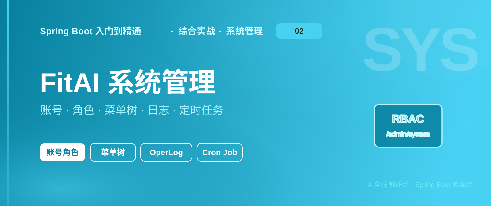

# 《Spring Boot 入门到精通》实战 - FitAI 系统管理

<table class="hero-banner" width="100%" cellspacing="0" cellpadding="0" style="border-collapse:separate;border:none;margin:0 0 4px 0;">
<tr>
<td style="padding:0;border:none;">

</td>
</tr>
</table>
<table class="hero-card" width="100%" cellspacing="0" cellpadding="0" style="border-collapse:separate;border:none;margin:0 0 18px 0;">
<tr>
<td style="padding:0;border:none;">

</td>
</tr>
</table>

> 📖 本章导读
>
> 本专篇是 FitAI 实战的第 03 篇。主笔记（01_…脚手架与认证.md）的 1.10～1.11 已经把所有 sys_* 表的管理端骨架铺齐了。本篇在骨架上加深业务，让学生跟着步骤，把系统管理从“能编译”做到“后台真能用”。
>
> 前置：请先完成主笔记 1.6～1.12（脚手架、校验映射、路径 Filter、权限注解、双端登录、异步登录日志）。本篇接口前缀统一 /admin/system。

> 💡 阅读约定
>
> 1、按章节序号 1.1 → 1.2 → … → 1.13 顺序做，做完一章验收再进入下一章
>
> 2、代码示例不写 package、import；类放到注释里写的路径即可
>
> 3、命名沿用主笔记：userName / findByPage / system:user:update / VO 出参 / Converter

## 1.1 本篇目录与学习目标

| 序号 | 章节 | 你要做出什么 |
| --- | --- | --- |
| 1.1 | 目录与约定 | 知道从哪跟、文件放哪 |
| 1.2 | 账号管理 | 加密、角色、重置密码、改状态 |
| 1.3 | 角色管理 | 菜单/部门授权、下拉、改状态 |
| 1.4 | 菜单管理 | 树、当前用户菜单、前端路由 |
| 1.5 | 部门管理 | 树、ancestors、禁删有子节点 |
| 1.6 | 字典管理 | 类型唯一、按类型取数据 |
| 1.7 | 系统配置 | 键唯一、按 key 读值 |
| 1.8 | 系统日志 | @OperLog 切面 + 清空 |
| 1.9 | 通知公告 | 发布/撤回/已读 |
| 1.10 | 定时任务 | 内置 Cron 调度 |
| 1.11 | 入口日统计 | 看板用简章 |
| 1.12 | 全模块自检 | 对照清单验收 |
| 1.13 | 章节小结 | 复盘 |

> 💡 文件落点（加深时主要改这些）
>
```text
modules/system/
├── code/SystemCode.java
├── controller/admin/SysXxxController.java
├── service/ + impl/
├── model/dto|vo|po/
├── log/OperLog.java + OperLogAspect.java      ← 1.8 新建
└── job/SysJobScheduler.java 等               ← 1.10 新建
```

---

## 1.2 账号管理

### 1.2.1 功能说明

管理后台管理员：分页、详情（带角色）、新增、修改、删除、重置密码、改状态。

账号 ↔ 角色是多对多，中间表 sys_user_role。前端一次提交 roleIds，后端事务里“先删后插”。

密码用 Hutool BCrypt 加密（与登录校验一致）。userId=1 超级管理员禁止删除、禁止改状态。

### 1.2.2 相关表

| 表名 | 说明 |
| --- | --- |
| sys_user | 后台管理员 |
| sys_user_role | 用户-角色 |

### 1.2.3 接口说明

| 方法 | 路径 | 权限码 | 说明 |
| --- | --- | --- | --- |
| GET | /admin/system/user/list | system:user:list | 分页 |
| GET | /admin/system/user/{userId} | system:user:list | 详情含 roleIds |
| POST | /admin/system/user | system:user:add | 新增 |
| PUT | /admin/system/user | system:user:update | 修改（密码空=不改） |
| DELETE | /admin/system/user/{userIds} | system:user:delete | 批量删 |
| PUT | /admin/system/user/resetPwd | system:user:update | query：userId、password |
| PUT | /admin/system/user/status | system:user:update | query：userId、status |

### 1.2.4 实现步骤

步骤 1：补齐错误码

打开 modules/system/code/SystemCode.java，把枚举常量改成下面这样（code() / msg() 方法保留不动）：

```java
// modules/system/code/SystemCode.java
public enum SystemCode implements ExceptionResult {
    USER_NOT_FOUND(2001, "用户不存在"),
    USER_DISABLED(2002, "用户已禁用"),
    PASSWORD_ERROR(2003, "密码错误"),
    USERNAME_EXISTS(2004, "用户名已存在"),
    SUPER_ADMIN_FORBIDDEN(2005, "不允许操作超级管理员"),
    ROLE_NOT_FOUND(2101, "角色不存在"),
    ROLE_KEY_EXISTS(2102, "角色标识已存在"),
    SUPER_ROLE_FORBIDDEN(2103, "不允许操作超级管理员角色"),
    MENU_NOT_FOUND(2201, "菜单不存在"),
    MENU_HAS_CHILDREN(2202, "存在子菜单，不允许删除"),
    DEPT_NOT_FOUND(2301, "部门不存在"),
    DEPT_HAS_CHILDREN(2302, "存在子部门，不允许删除"),
    DICT_TYPE_EXISTS(2401, "字典类型已存在"),
    CONFIG_KEY_EXISTS(2501, "配置键名已存在"),
    JOB_NOT_FOUND(2601, "定时任务不存在"),
    JOB_CRON_INVALID(2602, "Cron 表达式无效"),
    NOTICE_NOT_FOUND(2701, "公告不存在"),
    NOTICE_REVOKE_FORBIDDEN(2702, "仅已发布的公告可以撤回");
    // 下面保留原有字段、构造、code()、msg()
}
```

步骤 2：DTO / VO 增加 roleIds

在已有的 SysUserAddDTO、SysUserUpdateDTO、SysUserVO 末尾增加字段（别删原有字段）：

```java
// SysUserAddDTO / SysUserUpdateDTO
@Schema(description = "角色ID列表")
private List<Long> roleIds;

// SysUserUpdateDTO 里密码注释改一下
@Schema(description = "密码（空表示不修改）")
private String password;

// SysUserVO
@Schema(description = "角色ID列表（详情接口返回）")
private List<Long> roleIds;
```

SysUserAddDTO 的 status 可以改成非必填（新增时后端默认 "0"）。

步骤 3：扩展 Service 接口

SysUserServiceI 在原有方法基础上增加：

```java
void resetPassword(Long userId, String password);
void changeStatus(Long userId, String status);
List<Long> listRoleIds(Long userId);
```

步骤 4：重写业务实现（照抄到 SysUserServiceImpl）

说明：登录章用到的 getPermsByUserId / getRoleKeysByUserId / getAllPerms / getAllRoleKeys 保留不动，只改 CRUD 相关方法，并注入 SysUserRoleServiceI。

```java
// modules/system/service/impl/SysUserServiceImpl.java
@Service
@RequiredArgsConstructor
public class SysUserServiceImpl extends MPJBaseServiceImpl<SysUserMapper, SysUser> implements SysUserServiceI {

    private final Converter converter;
    private final SysMenuMapper sysMenuMapper;
    private final SysRoleMapper sysRoleMapper;
    private final SysUserRoleServiceI sysUserRoleService;

    @Override
    public IPage<SysUserVO> findByPage(SysUserQueryDTO queryDto) {
        IPage<SysUser> page = new Page<>(queryDto.getPageNum(), queryDto.getPageSize());
        LambdaQueryWrapper<SysUser> wrapper = new LambdaQueryWrapper<>();
        wrapper.like(StrUtil.isNotEmpty(queryDto.getUserName()), SysUser::getUserName, queryDto.getUserName());
        wrapper.like(StrUtil.isNotEmpty(queryDto.getNickName()), SysUser::getNickName, queryDto.getNickName());
        wrapper.like(StrUtil.isNotEmpty(queryDto.getPhonenumber()), SysUser::getPhonenumber, queryDto.getPhonenumber());
        wrapper.eq(StrUtil.isNotEmpty(queryDto.getStatus()), SysUser::getStatus, queryDto.getStatus());
        wrapper.eq(ObjectUtil.isNotNull(queryDto.getDeptId()), SysUser::getDeptId, queryDto.getDeptId());
        wrapper.orderByAsc(SysUser::getUserId);
        return this.page(page, wrapper).convert(item -> converter.convert(item, SysUserVO.class));
    }

    @Override
    public SysUserVO findById(Long userId) {
        SysUser entity = this.getById(userId);
        if (ObjectUtil.isNull(entity)) {
            throw new CustomException(SystemCode.USER_NOT_FOUND);
        }
        SysUserVO vo = converter.convert(entity, SysUserVO.class);
        vo.setRoleIds(listRoleIds(userId));
        return vo;
    }

    @Override
    @Transactional(rollbackFor = Exception.class)
    public void add(SysUserAddDTO addDto) {
        if (ObjectUtil.isNotNull(getByUserName(addDto.getUserName()))) {
            throw new CustomException(SystemCode.USERNAME_EXISTS);
        }
        SysUser entity = converter.convert(addDto, SysUser.class);
        entity.setPassword(BCrypt.hashpw(addDto.getPassword(), BCrypt.gensalt()));
        if (StrUtil.isBlank(entity.getStatus())) {
            entity.setStatus(CommonConstant.STATUS_NORMAL);
        }
        this.save(entity);
        sysUserRoleService.replaceByUserId(entity.getUserId(), addDto.getRoleIds());
    }

    @Override
    @Transactional(rollbackFor = Exception.class)
    public void update(SysUserUpdateDTO updateDto) {
        SysUser db = this.getById(updateDto.getUserId());
        if (ObjectUtil.isNull(db)) {
            throw new CustomException(SystemCode.USER_NOT_FOUND);
        }
        if (StrUtil.isNotBlank(updateDto.getUserName())
                && !updateDto.getUserName().equals(db.getUserName())
                && ObjectUtil.isNotNull(getByUserName(updateDto.getUserName()))) {
            throw new CustomException(SystemCode.USERNAME_EXISTS);
        }
        SysUser entity = converter.convert(updateDto, SysUser.class);
        if (StrUtil.isNotBlank(updateDto.getPassword())) {
            entity.setPassword(BCrypt.hashpw(updateDto.getPassword(), BCrypt.gensalt()));
        } else {
            entity.setPassword(null); // 不改密码
        }
        this.updateById(entity);
        sysUserRoleService.replaceByUserId(updateDto.getUserId(), updateDto.getRoleIds());
    }

    @Override
    @Transactional(rollbackFor = Exception.class)
    public void delete(List<Long> ids) {
        if (ids != null && ids.contains(CommonConstant.SUPER_ADMIN_ID)) {
            throw new CustomException(SystemCode.SUPER_ADMIN_FORBIDDEN);
        }
        for (Long userId : ids) {
            sysUserRoleService.replaceByUserId(userId, List.of());
        }
        this.removeByIds(ids);
    }

    @Override
    public void resetPassword(Long userId, String password) {
        if (ObjectUtil.isNull(this.getById(userId))) {
            throw new CustomException(SystemCode.USER_NOT_FOUND);
        }
        SysUser entity = new SysUser();
        entity.setUserId(userId);
        entity.setPassword(BCrypt.hashpw(password, BCrypt.gensalt()));
        this.updateById(entity);
    }

    @Override
    public void changeStatus(Long userId, String status) {
        if (CommonConstant.SUPER_ADMIN_ID.equals(userId)) {
            throw new CustomException(SystemCode.SUPER_ADMIN_FORBIDDEN);
        }
        SysUser entity = new SysUser();
        entity.setUserId(userId);
        entity.setStatus(status);
        this.updateById(entity);
    }

    @Override
    public List<Long> listRoleIds(Long userId) {
        return sysUserRoleService.listByUserId(userId).stream()
                .map(SysUserRole::getRoleId)
                .toList();
    }

    // getByUserName / getPermsByUserId / getRoleKeysByUserId / getAllPerms / getAllRoleKeys
    // 保持登录章已有实现，此处不重复粘贴
}
```

步骤 5：补全 Controller

把 SysUserController 改成下面完整类（路径不变）：

```java
// modules/system/controller/admin/SysUserController.java
@RestController
@RequestMapping("/admin/system/user")
@RequiredArgsConstructor
@Tag(name = "后台用户管理")
public class SysUserController {

    private final SysUserServiceI sysUserService;

    @GetMapping("/list")
    @Operation(summary = "分页查询后台用户")
    @SaCheckPermission("system:user:list")
    public AjaxResult<IPage<SysUserVO>> findByPage(SysUserQueryDTO queryDto) {
        return AjaxResult.success(sysUserService.findByPage(queryDto));
    }

    @GetMapping("/{userId}")
    @Operation(summary = "根据主键查询后台用户（含角色）")
    @SaCheckPermission("system:user:list")
    public AjaxResult<SysUserVO> findById(@PathVariable("userId") Long userId) {
        return AjaxResult.success(sysUserService.findById(userId));
    }

    @PostMapping
    @Operation(summary = "新增后台用户")
    @SaCheckPermission("system:user:add")
    public AjaxResult<Void> add(@Valid @RequestBody SysUserAddDTO addDto) {
        sysUserService.add(addDto);
        return AjaxResult.success();
    }

    @PutMapping
    @Operation(summary = "修改后台用户")
    @SaCheckPermission("system:user:update")
    public AjaxResult<Void> update(@Valid @RequestBody SysUserUpdateDTO updateDto) {
        sysUserService.update(updateDto);
        return AjaxResult.success();
    }

    @DeleteMapping("/{userIds}")
    @Operation(summary = "删除后台用户")
    @SaCheckPermission("system:user:delete")
    public AjaxResult<Void> delete(@PathVariable List<Long> userIds) {
        sysUserService.delete(userIds);
        return AjaxResult.success();
    }

    @PutMapping("/resetPwd")
    @Operation(summary = "重置密码")
    @SaCheckPermission("system:user:update")
    public AjaxResult<Void> resetPwd(@RequestParam("userId") Long userId,
                                     @RequestParam("password") String password) {
        sysUserService.resetPassword(userId, password);
        return AjaxResult.success();
    }

    @PutMapping("/status")
    @Operation(summary = "修改状态")
    @SaCheckPermission("system:user:update")
    public AjaxResult<Void> changeStatus(@RequestParam("userId") Long userId,
                                         @RequestParam("status") String status) {
        sysUserService.changeStatus(userId, status);
        return AjaxResult.success();
    }
}
```

步骤 6：编译

```bash
mvn -pl fitai-server -am compile
```

### 1.2.5 本步验收

> ✅ 验收清单
>
> 1、编译通过
>
> 2、POST /admin/system/user body 带 roleIds，库里密码是 $2a$ 开头，sys_user_role 有行
>
> 3、GET /admin/system/user/{id} 返回 roleIds
>
> 4、PUT .../resetPwd?userId=2&password=abc123 后可用新密码登录
>
> 5、删除 userId=1 返回“不允许操作超级管理员”

---

## 1.3 角色管理

### 1.3.1 功能说明

角色分页、全部下拉、详情（含菜单/部门）、增改删、改状态。  
增改时一次提交 menuIds、deptIds，事务内覆盖 sys_role_menu / sys_role_dept。  
roleId=1 禁止删除与改状态；roleKey 全局唯一。

### 1.3.2 相关表

| 表名 | 说明 |
| --- | --- |
| sys_role | 角色 |
| sys_role_menu | 角色-菜单 |
| sys_role_dept | 角色-部门（数据权限） |

### 1.3.3 接口说明

| 方法 | 路径 | 权限 | 说明 |
| --- | --- | --- | --- |
| GET | /admin/system/role/list | system:role:list | 分页 |
| GET | /admin/system/role/all | system:role:list | 下拉（status=0） |
| GET | /admin/system/role/{roleId} | system:role:list | 详情含 menuIds/deptIds |
| POST / PUT | /admin/system/role | add/update | 增改 |
| DELETE | /admin/system/role/{roleIds} | delete | 批量删 |
| PUT | /admin/system/role/status | update | 改状态 |

### 1.3.4 实现步骤

步骤 1：DTO / VO 加字段

```java
// SysRoleAddDTO、SysRoleUpdateDTO
@Schema(description = "菜单ID列表")
private List<Long> menuIds;
@Schema(description = "部门ID列表（数据权限）")
private List<Long> deptIds;

// SysRoleVO 同样增加 menuIds、deptIds
```

步骤 2：Service 接口

```java
public interface SysRoleServiceI extends MPJBaseService<SysRole> {
    IPage<SysRoleVO> findByPage(SysRoleQueryDTO queryDto);
    List<SysRoleVO> listAll();
    SysRoleVO findById(Long roleId);
    void add(SysRoleAddDTO addDto);
    void update(SysRoleUpdateDTO updateDto);
    void delete(List<Long> ids);
    void changeStatus(Long roleId, String status);
    List<Long> listMenuIds(Long roleId);
    List<Long> listDeptIds(Long roleId);
}
```

步骤 3：实现类（核心逻辑）

```java
@Service
@RequiredArgsConstructor
public class SysRoleServiceImpl extends MPJBaseServiceImpl<SysRoleMapper, SysRole> implements SysRoleServiceI {

    private final Converter converter;
    private final SysRoleMenuServiceI sysRoleMenuService;
    private final SysRoleDeptServiceI sysRoleDeptService;

    @Override
    public List<SysRoleVO> listAll() {
        return this.list(new LambdaQueryWrapper<SysRole>()
                        .eq(SysRole::getStatus, CommonConstant.STATUS_NORMAL)
                        .orderByAsc(SysRole::getRoleSort))
                .stream().map(i -> converter.convert(i, SysRoleVO.class)).toList();
    }

    @Override
    public SysRoleVO findById(Long roleId) {
        SysRole entity = this.getById(roleId);
        if (ObjectUtil.isNull(entity)) {
            throw new CustomException(SystemCode.ROLE_NOT_FOUND);
        }
        SysRoleVO vo = converter.convert(entity, SysRoleVO.class);
        vo.setMenuIds(listMenuIds(roleId));
        vo.setDeptIds(listDeptIds(roleId));
        return vo;
    }

    @Override
    @Transactional(rollbackFor = Exception.class)
    public void add(SysRoleAddDTO addDto) {
        long count = this.count(new LambdaQueryWrapper<SysRole>().eq(SysRole::getRoleKey, addDto.getRoleKey()));
        if (count > 0) {
            throw new CustomException(SystemCode.ROLE_KEY_EXISTS);
        }
        SysRole entity = converter.convert(addDto, SysRole.class);
        if (StrUtil.isBlank(entity.getStatus())) {
            entity.setStatus(CommonConstant.STATUS_NORMAL);
        }
        this.save(entity);
        sysRoleMenuService.replaceByRoleId(entity.getRoleId(), addDto.getMenuIds());
        sysRoleDeptService.replaceByRoleId(entity.getRoleId(), addDto.getDeptIds());
    }

    @Override
    @Transactional(rollbackFor = Exception.class)
    public void update(SysRoleUpdateDTO updateDto) {
        // 查存在 + roleKey 查重（排除自己）后 updateById
        // 再 replaceByRoleId 菜单与部门
        SysRole entity = converter.convert(updateDto, SysRole.class);
        this.updateById(entity);
        sysRoleMenuService.replaceByRoleId(updateDto.getRoleId(), updateDto.getMenuIds());
        sysRoleDeptService.replaceByRoleId(updateDto.getRoleId(), updateDto.getDeptIds());
    }

    @Override
    @Transactional(rollbackFor = Exception.class)
    public void delete(List<Long> ids) {
        if (ids != null && ids.contains(CommonConstant.SUPER_ADMIN_ID)) {
            throw new CustomException(SystemCode.SUPER_ROLE_FORBIDDEN);
        }
        for (Long roleId : ids) {
            sysRoleMenuService.replaceByRoleId(roleId, List.of());
            sysRoleDeptService.replaceByRoleId(roleId, List.of());
        }
        this.removeByIds(ids);
    }

    @Override
    public void changeStatus(Long roleId, String status) {
        if (CommonConstant.SUPER_ADMIN_ID.equals(roleId)) {
            throw new CustomException(SystemCode.SUPER_ROLE_FORBIDDEN);
        }
        SysRole entity = new SysRole();
        entity.setRoleId(roleId);
        entity.setStatus(status);
        this.updateById(entity);
    }

    @Override
    public List<Long> listMenuIds(Long roleId) {
        return sysRoleMenuService.listByRoleId(roleId).stream().map(SysRoleMenu::getMenuId).toList();
    }

    @Override
    public List<Long> listDeptIds(Long roleId) {
        return sysRoleDeptService.listByRoleId(roleId).stream().map(SysRoleDept::getDeptId).toList();
    }
}
```

步骤 4：Controller——注意路径顺序

/all、/status 必须写在 /{roleId} 上面。

```java
@RestController
@RequestMapping("/admin/system/role")
@RequiredArgsConstructor
@Tag(name = "角色管理")
public class SysRoleController {

    private final SysRoleServiceI sysRoleService;

    @GetMapping("/list")
    @SaCheckPermission("system:role:list")
    public AjaxResult<IPage<SysRoleVO>> findByPage(SysRoleQueryDTO queryDto) {
        return AjaxResult.success(sysRoleService.findByPage(queryDto));
    }

    @GetMapping("/all")
    @SaCheckPermission("system:role:list")
    public AjaxResult<List<SysRoleVO>> listAll() {
        return AjaxResult.success(sysRoleService.listAll());
    }

    @GetMapping("/{roleId}")
    @SaCheckPermission("system:role:list")
    public AjaxResult<SysRoleVO> findById(@PathVariable Long roleId) {
        return AjaxResult.success(sysRoleService.findById(roleId));
    }

    @PostMapping
    @SaCheckPermission("system:role:add")
    public AjaxResult<Void> add(@Valid @RequestBody SysRoleAddDTO addDto) {
        sysRoleService.add(addDto);
        return AjaxResult.success();
    }

    @PutMapping
    @SaCheckPermission("system:role:update")
    public AjaxResult<Void> update(@Valid @RequestBody SysRoleUpdateDTO updateDto) {
        sysRoleService.update(updateDto);
        return AjaxResult.success();
    }

    @DeleteMapping("/{roleIds}")
    @SaCheckPermission("system:role:delete")
    public AjaxResult<Void> delete(@PathVariable List<Long> roleIds) {
        sysRoleService.delete(roleIds);
        return AjaxResult.success();
    }

    @PutMapping("/status")
    @SaCheckPermission("system:role:update")
    public AjaxResult<Void> changeStatus(@RequestParam Long roleId, @RequestParam String status) {
        sysRoleService.changeStatus(roleId, status);
        return AjaxResult.success();
    }
}
```

### 1.3.5 本步验收

> ✅ POST 带 menuIds 后 sys_role_menu 有数据；GET /all 只返回正常角色；删 roleId=1 被拒绝。

---

## 1.4 菜单管理

### 1.4.1 功能说明

菜单类型：M 目录、C 菜单、F 按钮。  
列表改成树；下拉不含按钮；提供当前用户菜单与前端路由。  
有子菜单禁止删；roleKey=admin 返回全量。库表约定：status=0 正常，visible=0 显示。

### 1.4.2 相关表

| 表名 | 说明 |
| --- | --- |
| sys_menu | 菜单权限 |

### 1.4.3 接口说明

| 方法 | 路径 | 权限 | 说明 |
| --- | --- | --- | --- |
| GET | /list | list | 菜单树 |
| GET | /select | list | 下拉树（无 F） |
| GET | /user | 登录即可 | 当前用户菜单 |
| GET | /routers | 登录即可 | 前端路由 |
| GET | /{menuId} | list | 详情 |
| POST / PUT | / | add/update | 增改 |
| DELETE | /{menuId} | delete | 删单个 |

### 1.4.4 实现步骤

步骤 1：SysMenuVO 加 children；新建 RouterVO

```java
// SysMenuVO 末尾
@Schema(description = "子菜单")
private List<SysMenuVO> children = new ArrayList<>();

// modules/system/model/vo/RouterVO.java
@Data
public class RouterVO implements Serializable {
    private String path;
    private String name;
    private String component;
    private String redirect;
    private Meta meta;
    private List<RouterVO> children = new ArrayList<>();

    @Data
    public static class Meta implements Serializable {
        private String title;
        private String icon;
        private Boolean isHide = false;
        private Boolean isKeepAlive = true;
    }
}
```

步骤 2：Service 接口改成树形态

```java
public interface SysMenuServiceI extends MPJBaseService<SysMenu> {
    List<SysMenuVO> listTree(SysMenuQueryDTO queryDto);
    List<SysMenuVO> listSelect();
    List<SysMenuVO> listTreeForCurrentUser();
    List<RouterVO> buildRoutersForCurrentUser();
    SysMenuVO findById(Long menuId);
    void add(SysMenuAddDTO addDto);
    void update(SysMenuUpdateDTO updateDto);
    void delete(Long menuId);
}
```

步骤 3：实现建树 + ancestors + 当前用户路由

核心私有方法（必须写对）：

```java
private List<SysMenuVO> buildTree(Long parentId, List<SysMenuVO> all) {
    List<SysMenuVO> result = new ArrayList<>();
    for (SysMenuVO menu : all) {
        if (ObjectUtil.equals(menu.getParentId(), parentId)) {
            menu.setChildren(buildTree(menu.getMenuId(), all));
            result.add(menu);
        }
    }
    return result;
}

private void fillAncestors(SysMenu entity) {
    Long parentId = entity.getParentId();
    if (ObjectUtil.isNull(parentId) || parentId == 0L) {
        entity.setParentId(0L);
        entity.setAncestors("0");
        return;
    }
    SysMenu parent = this.getById(parentId);
    if (ObjectUtil.isNull(parent)) {
        throw new CustomException(SystemCode.MENU_NOT_FOUND);
    }
    entity.setAncestors(StrUtil.blankToDefault(parent.getAncestors(), "0") + "," + parentId);
}
```

当前用户路由逻辑：

```java
@Override
public List<RouterVO> buildRoutersForCurrentUser() {
    List<String> roles = StpKit.ADMIN.getRoleList();
    List<SysMenu> menus;
    if (roles != null && roles.contains("admin")) {
        menus = this.list(new LambdaQueryWrapper<SysMenu>()
                .ne(SysMenu::getMenuType, "F")
                .eq(SysMenu::getStatus, CommonConstant.STATUS_NORMAL)
                .eq(SysMenu::getVisible, "0")
                .orderByAsc(SysMenu::getParentId).orderByAsc(SysMenu::getOrderNum));
    } else {
        // MPJ：menu join role_menu join user_role，按当前 userId 过滤，去重
        menus = listMenusByUserId(AdminLoginHelper.getUserId(), true);
    }
    List<SysMenuVO> tree = buildTree(0L, menus.stream()
            .map(m -> converter.convert(m, SysMenuVO.class)).toList());
    return buildRouterTree(tree);
}
```

删除：

```java
public void delete(Long menuId) {
    long childCount = this.count(new LambdaQueryWrapper<SysMenu>().eq(SysMenu::getParentId, menuId));
    if (childCount > 0) {
        throw new CustomException(SystemCode.MENU_HAS_CHILDREN);
    }
    this.removeById(menuId);
}
```

步骤 4：Controller（静态路径在前）

```java
@RestController
@RequestMapping("/admin/system/menu")
@RequiredArgsConstructor
@Tag(name = "菜单管理")
public class SysMenuController {

    private final SysMenuServiceI sysMenuService;

    @GetMapping("/list")
    @SaCheckPermission("system:menu:list")
    public AjaxResult<List<SysMenuVO>> listTree(SysMenuQueryDTO queryDto) {
        return AjaxResult.success(sysMenuService.listTree(queryDto));
    }

    @GetMapping("/select")
    @SaCheckPermission("system:menu:list")
    public AjaxResult<List<SysMenuVO>> listSelect() {
        return AjaxResult.success(sysMenuService.listSelect());
    }

    @GetMapping("/user")
    public AjaxResult<List<SysMenuVO>> listForCurrentUser() {
        return AjaxResult.success(sysMenuService.listTreeForCurrentUser());
    }

    @GetMapping("/routers")
    public AjaxResult<List<RouterVO>> routers() {
        return AjaxResult.success(sysMenuService.buildRoutersForCurrentUser());
    }

    @GetMapping("/{menuId}")
    @SaCheckPermission("system:menu:list")
    public AjaxResult<SysMenuVO> findById(@PathVariable Long menuId) {
        return AjaxResult.success(sysMenuService.findById(menuId));
    }

    @PostMapping
    @SaCheckPermission("system:menu:add")
    public AjaxResult<Void> add(@Valid @RequestBody SysMenuAddDTO addDto) {
        sysMenuService.add(addDto);
        return AjaxResult.success();
    }

    @PutMapping
    @SaCheckPermission("system:menu:update")
    public AjaxResult<Void> update(@Valid @RequestBody SysMenuUpdateDTO updateDto) {
        sysMenuService.update(updateDto);
        return AjaxResult.success();
    }

    @DeleteMapping("/{menuId}")
    @SaCheckPermission("system:menu:delete")
    public AjaxResult<Void> delete(@PathVariable Long menuId) {
        sysMenuService.delete(menuId);
        return AjaxResult.success();
    }
}
```

### 1.4.5 本步验收

> ✅ /list 带 children；登录后 /routers 有数据；删有子节点的菜单被拒绝。

---

## 1.5 部门管理

### 1.5.1 功能说明

部门树 + 下拉；维护 ancestors；有子部门禁删。  
按名称过滤时父节点可能不在结果里——用“森林”：父不在列表则当根。

### 1.5.2～1.5.3 表与接口

表：sys_dept。  
接口：GET /list 树、GET /select 下拉、GET /{deptId}、POST、PUT、DELETE /{deptId}。

### 1.5.4 实现步骤

步骤 1： SysDeptVO 加 List<SysDeptVO> children。

步骤 2： Service 接口改为 listTree / listSelect / delete(Long)（不再批量分页）。

步骤 3： 实现 fillAncestors（同菜单）+ buildForest：

```java
private List<SysDeptVO> buildForest(List<SysDeptVO> depts) {
    Set<Long> ids = depts.stream().map(SysDeptVO::getDeptId).collect(Collectors.toSet());
    List<SysDeptVO> roots = new ArrayList<>();
    for (SysDeptVO dept : depts) {
        Long parentId = dept.getParentId();
        if (ObjectUtil.isNull(parentId) || !ids.contains(parentId)) {
            dept.setChildren(buildChildren(dept.getDeptId(), depts));
            roots.add(dept);
        }
    }
    return roots;
}

private List<SysDeptVO> buildChildren(Long parentId, List<SysDeptVO> all) {
    List<SysDeptVO> children = new ArrayList<>();
    for (SysDeptVO dept : all) {
        if (ObjectUtil.equals(dept.getParentId(), parentId)) {
            dept.setChildren(buildChildren(dept.getDeptId(), all));
            children.add(dept);
        }
    }
    return children;
}
```

步骤 4： Controller 与菜单类似，/list、/select 在 /{deptId} 前。

### 1.5.5 本步验收

> ✅ 树接口通；子部门 ancestors 形如 0,100；删父部门被拒。

---

## 1.6 字典管理

### 1.6.1 功能说明

类型表 + 数据表。加深：类型编码唯一、GET /type/all、GET /data/type/{dictType}。

### 1.6.2 接口

类型 /admin/system/dict/type：/list、/all、CRUD。  
数据 /admin/system/dict/data：/list、/type/{dictType}、CRUD。

### 1.6.3 实现步骤

步骤 1：类型 Service 增加 listAll + 查重

```java
public List<SysDictTypeVO> listAll() {
    return this.list(new LambdaQueryWrapper<SysDictType>()
                    .eq(SysDictType::getStatus, CommonConstant.STATUS_NORMAL)
                    .orderByAsc(SysDictType::getDictId))
            .stream().map(i -> converter.convert(i, SysDictTypeVO.class)).toList();
}

public void add(SysDictTypeAddDTO addDto) {
    long count = this.count(new LambdaQueryWrapper<SysDictType>()
            .eq(SysDictType::getDictType, addDto.getDictType()));
    if (count > 0) {
        throw new CustomException(SystemCode.DICT_TYPE_EXISTS);
    }
    this.save(converter.convert(addDto, SysDictType.class));
}
```

步骤 2：数据 Service 增加按类型查询

```java
public List<SysDictDataVO> listByDictType(String dictType) {
    return this.list(new LambdaQueryWrapper<SysDictData>()
                    .eq(SysDictData::getDictType, dictType)
                    .eq(SysDictData::getStatus, CommonConstant.STATUS_NORMAL)
                    .orderByAsc(SysDictData::getDictSort))
            .stream().map(i -> converter.convert(i, SysDictDataVO.class)).toList();
}
```

步骤 3：Controller

类型加 @GetMapping("/all")（写在 /{dictId} 前）。  
数据加 @GetMapping("/type/{dictType}")（写在 /{dictCode} 前；可无权限注解，方便业务下拉）。

### 1.6.4 本步验收

> ✅ GET /admin/system/dict/data/type/sys_user_sex 返回男/女/未知。

---

## 1.7 系统配置加深

### 1.7.1 功能说明

骨架已有 CRUD 与 GET /key/{configKey}。本步只补 configKey 唯一。

### 1.7.2 实现步骤

在 SysConfigServiceImpl 的 add / update：

```java
public void add(SysConfigAddDTO addDto) {
    long count = this.count(new LambdaQueryWrapper<SysConfig>()
            .eq(SysConfig::getConfigKey, addDto.getConfigKey()));
    if (count > 0) {
        throw new CustomException(SystemCode.CONFIG_KEY_EXISTS);
    }
    this.save(converter.convert(addDto, SysConfig.class));
}

public void update(SysConfigUpdateDTO updateDto) {
    if (StrUtil.isNotBlank(updateDto.getConfigKey())) {
        long count = this.count(new LambdaQueryWrapper<SysConfig>()
                .eq(SysConfig::getConfigKey, updateDto.getConfigKey())
                .ne(SysConfig::getConfigId, updateDto.getConfigId()));
        if (count > 0) {
            throw new CustomException(SystemCode.CONFIG_KEY_EXISTS);
        }
    }
    this.updateById(converter.convert(updateDto, SysConfig.class));
}
```

getValueByKey 保持：

```java
public String getValueByKey(String configKey) {
    SysConfig config = this.getOne(new LambdaQueryWrapper<SysConfig>()
            .eq(SysConfig::getConfigKey, configKey));
    return ObjectUtil.isNotNull(config) ? config.getConfigValue() : null;
}
```

### 1.7.3 本步验收

> ✅ 重复键名新增失败；GET .../key/sys.user.initPassword 返回种子值 123456。

---

## 1.8 系统日志

### 1.8.1 功能说明

1、操作日志：方法加 @OperLog，切面写 sys_oper_log  
2、登录日志：写入已在主笔记 1.12；本步补清空  
状态约定：操作日志 0 正常 / 1 异常。

### 1.8.2 步骤 1：加依赖（Boot 4）

在 `fitai-server/pom.xml` 增加（版本由父 BOM 管理，不要写 version）：

```xml
<dependency>
    <groupId>org.springframework.boot</groupId>
    <artifactId>spring-boot-starter-aspectj</artifactId>
</dependency>
```

> ⚠️ Boot 3 叫 spring-boot-starter-aop，Boot 4 改名为 spring-boot-starter-aspectj。

### 1.8.3 步骤 2：注解

新建 modules/system/log/OperLog.java：

```java
@Target(ElementType.METHOD)
@Retention(RetentionPolicy.RUNTIME)
public @interface OperLog {
    String title() default "";
    /** 0其它 1新增 2修改 3删除 */
    int businessType() default 0;
    boolean saveRequestData() default true;
}
```

### 1.8.4 步骤 3：切面

新建 modules/system/log/OperLogAspect.java：

```java
@Slf4j
@Aspect
@Component
@RequiredArgsConstructor
public class OperLogAspect {

    private final SysOperLogServiceI operLogService;

    @Around("@annotation(operLog)")
    public Object around(ProceedingJoinPoint point, OperLog operLog) throws Throwable {
        long start = System.currentTimeMillis();
        Object result = null;
        Exception error = null;
        try {
            result = point.proceed();
            return result;
        } catch (Exception ex) {
            error = ex;
            throw ex;
        } finally {
            try {
                saveLog(point, operLog, result, error, System.currentTimeMillis() - start);
            } catch (Exception ex) {
                log.error("操作日志记录失败", ex);
            }
        }
    }

    private void saveLog(ProceedingJoinPoint point, OperLog operLog,
                         Object result, Exception error, long cost) {
        SysOperLog entity = new SysOperLog();
        entity.setTitle(operLog.title());
        entity.setBusinessType(operLog.businessType());
        entity.setStatus(error == null ? CommonConstant.STATUS_NORMAL : CommonConstant.STATUS_DISABLED);
        entity.setCostTime(cost);
        entity.setOperTime(LocalDateTime.now());
        MethodSignature signature = (MethodSignature) point.getSignature();
        entity.setMethod(StrUtil.sub(
                signature.getDeclaringTypeName() + "." + signature.getName() + "()", 0, 100));

        ServletRequestAttributes attrs =
                (ServletRequestAttributes) RequestContextHolder.getRequestAttributes();
        if (attrs != null) {
            HttpServletRequest request = attrs.getRequest();
            entity.setRequestMethod(request.getMethod());
            entity.setOperUrl(StrUtil.sub(request.getRequestURI(), 0, 255));
            entity.setOperIp(resolveClientIp(request));
        }
        String username = AdminLoginHelper.getUsername();
        if (StrUtil.isNotBlank(username)) {
            entity.setOperName(username);
        }
        if (operLog.saveRequestData()) {
            try {
                entity.setOperParam(StrUtil.sub(JSONUtil.toJsonStr(point.getArgs()), 0, 2000));
            } catch (Exception ignore) { }
        }
        if (error != null) {
            entity.setErrorMsg(StrUtil.sub(error.getMessage(), 0, 500));
        }
        operLogService.recordOperLog(entity);
    }

    private static String resolveClientIp(HttpServletRequest request) {
        String ip = request.getHeader("X-Forwarded-For");
        if (StrUtil.isNotBlank(ip)) {
            return ip.split(",")[0].trim();
        }
        ip = request.getHeader("X-Real-IP");
        return StrUtil.isNotBlank(ip) ? ip : request.getRemoteAddr();
    }
}
```

### 1.8.5 步骤 4：Service 增加 record / clean

```java
// SysOperLogServiceI
void clean();
void recordOperLog(SysOperLog operLog);

// Impl
public void clean() { this.remove(new LambdaQueryWrapper<>()); }
public void recordOperLog(SysOperLog operLog) { this.save(operLog); }

// SysLoginLogServiceI / Impl 同样加 clean()
```

### 1.8.6 步骤 5：Controller 清空接口

/clean 必须写在 /{ids} 上面：

```java
@DeleteMapping("/clean")
@SaCheckPermission("system:operlog:delete")
public AjaxResult<Void> clean() {
    sysOperLogService.clean();
    return AjaxResult.success();
}
```

登录日志同理：DELETE /admin/system/login-log/clean。

### 1.8.7 步骤 6：在业务方法上挂注解

```java
@PostMapping
@OperLog(title = "账号管理", businessType = 1)
public AjaxResult<Void> add(...) { ... }
```

### 1.8.8 本步验收

> ✅ 带 @OperLog 的新增用户后 sys_oper_log 多一行；清空接口可用。

---

## 1.9 通知公告

### 1.9.1 功能说明

状态：0 草稿 → 1 已发布 → 2 撤回。  
发布写 publishTime；删除级联清已读；支持已读统计与标记已读。

### 1.9.2 相关表

| 表名 | 说明 |
| --- | --- |
| sys_notice | 公告 |
| sys_notice_read | 已读（字段 customerId） |

### 1.9.3 实现步骤

步骤 1：Service 接口增加

```java
void publish(Long noticeId);
void revoke(Long noticeId);
void markRead(Long noticeId, Long customerId);
long countReads(Long noticeId);
List<SysNoticeRead> listReads(Long noticeId);
```

步骤 2：实现

```java
private static final String STATUS_DRAFT = "0";
private static final String STATUS_PUBLISHED = "1";
private static final String STATUS_REVOKED = "2";

public void publish(Long noticeId) {
    SysNotice entity = require(noticeId);
    entity.setStatus(STATUS_PUBLISHED);
    entity.setPublishTime(LocalDateTime.now());
    this.updateById(entity);
}

public void revoke(Long noticeId) {
    SysNotice entity = require(noticeId);
    if (!STATUS_PUBLISHED.equals(entity.getStatus())) {
        throw new CustomException(SystemCode.NOTICE_REVOKE_FORBIDDEN);
    }
    entity.setStatus(STATUS_REVOKED);
    this.updateById(entity);
}

@Transactional(rollbackFor = Exception.class)
public void delete(List<Long> ids) {
    this.removeByIds(ids);
    sysNoticeReadService.remove(new LambdaQueryWrapper<SysNoticeRead>()
            .in(SysNoticeRead::getNoticeId, ids));
}

public void markRead(Long noticeId, Long customerId) {
    long exists = sysNoticeReadService.count(new LambdaQueryWrapper<SysNoticeRead>()
            .eq(SysNoticeRead::getNoticeId, noticeId)
            .eq(SysNoticeRead::getCustomerId, customerId));
    if (exists > 0) {
        return;
    }
    SysNoticeRead read = new SysNoticeRead();
    read.setNoticeId(noticeId);
    read.setCustomerId(customerId);
    read.setReadTime(LocalDateTime.now());
    sysNoticeReadService.save(read);
}
```

步骤 3：Controller 新增接口

```java
@PutMapping("/{noticeId}/publish")
@SaCheckPermission("system:notice:update")
public AjaxResult<Void> publish(@PathVariable Long noticeId) {
    sysNoticeService.publish(noticeId);
    return AjaxResult.success();
}

@PutMapping("/{noticeId}/revoke")
@SaCheckPermission("system:notice:update")
public AjaxResult<Void> revoke(@PathVariable Long noticeId) {
    sysNoticeService.revoke(noticeId);
    return AjaxResult.success();
}

@GetMapping("/{noticeId}/read-stats")
@SaCheckPermission("system:notice:list")
public AjaxResult<Long> readStats(@PathVariable Long noticeId) {
    return AjaxResult.success(sysNoticeService.countReads(noticeId));
}

@GetMapping("/{noticeId}/read-list")
@SaCheckPermission("system:notice:list")
public AjaxResult<List<SysNoticeRead>> readList(@PathVariable Long noticeId) {
    return AjaxResult.success(sysNoticeService.listReads(noticeId));
}

@PostMapping("/{noticeId}/read")
public AjaxResult<Void> markRead(@PathVariable Long noticeId, @RequestParam Long customerId) {
    sysNoticeService.markRead(noticeId, customerId);
    return AjaxResult.success();
}
```

### 1.9.4 本步验收

> ✅ 草稿发布后 status=1 且有 publishTime；非已发布撤回失败；删公告后已读记录消失。

---

## 1.10 定时任务（内置调度）

### 1.10.1 功能说明

不用 XXL-Job。用 ThreadPoolTaskScheduler + CronTrigger：启动加载 status=0 任务；增改/启停同步调度；执行写 sys_job_log。  
调用目标：bean名.方法名(参数)，例 sysJobDemoTask.noParams()。

### 1.10.2 相关表

| 表名 | 说明 |
| --- | --- |
| sys_job | 任务定义 |
| sys_job_log | 执行日志 |

### 1.10.3 实现步骤

步骤 1：演示 Bean

新建 modules/system/job/SysJobDemoTask.java：

```java
@Slf4j
@Component("sysJobDemoTask")
public class SysJobDemoTask {
    public void noParams() {
        log.info("sysJobDemoTask.noParams 执行成功");
    }
    public void withParams(String name, Long count) {
        log.info("sysJobDemoTask.withParams name={} count={}", name, count);
    }
}
```

步骤 2：调用目标工具 SysJobInvokeUtil

公开两个方法：validate(invokeTarget)、invoke(context, invokeTarget)。  
解析规则：最后一个 . 前是 bean 名，后面是方法名，括号内逗号分隔参数（支持引号字符串 / 数字 / 布尔）。

步骤 3：调度器 SysJobScheduler

实现 ApplicationRunner + DisposableBean：

1、@PostConstruct 初始化 ThreadPoolTaskScheduler（poolSize=4）  
2、run：查 status=0 的任务，逐个 scheduleJob  
3、scheduleJob：先 cancelJob，再 CronTrigger 注册  
4、executeJob：反射调用 + 写 sys_job_log；concurrent=1 时禁止并发

关键公开方法：

```java
public boolean isValidCron(String cronExpression);
public synchronized void scheduleJob(SysJob job);
public synchronized void cancelJob(Long jobId);
public boolean executeJob(SysJob job, String triggerType);
```

步骤 4：SysJobServiceImpl 接入调度器

```java
// add / update：校验 cron + invokeTarget，save 后 scheduleJob
// delete：先 cancelJob 再 removeByIds
public void changeStatus(Long jobId, String status) {
    SysJob entity = this.getById(jobId);
    if (ObjectUtil.isNull(entity)) {
        throw new CustomException(SystemCode.JOB_NOT_FOUND);
    }
    entity.setStatus(status);
    this.updateById(entity);
    sysJobScheduler.scheduleJob(entity);
}

public void runOnce(Long jobId) {
    SysJob entity = this.getById(jobId);
    if (ObjectUtil.isNull(entity)) {
        throw new CustomException(SystemCode.JOB_NOT_FOUND);
    }
    sysJobScheduler.executeJob(entity, "手动执行");
}
```

步骤 5：Controller 新接口

```java
@PutMapping("/status")
@SaCheckPermission("system:job:update")
public AjaxResult<Void> changeStatus(@RequestParam Long jobId, @RequestParam String status) {
    sysJobService.changeStatus(jobId, status);
    return AjaxResult.success();
}

@PutMapping("/{jobId}/run")
@SaCheckPermission("system:job:update")
public AjaxResult<Void> runOnce(@PathVariable Long jobId) {
    sysJobService.runOnce(jobId);
    return AjaxResult.success();
}
```

任务日志：DELETE /admin/system/job/log/clean（写在 /{ids} 前）。

### 1.10.4 本步验收

> ✅ 新增 invokeTarget=sysJobDemoTask.noParams()；status 改为 0；点执行一次后 sys_job_log 有成功记录。

---

## 1.11 入口日统计（简章）

### 1.11.1 功能说明

sys_entry_daily 给看板用（按日 UV/PV）。骨架已有 list / 详情 / 新增 / 删除，本步不加深。  
路径：/admin/system/entry-daily，权限 system:entry:*。

### 1.11.2 本步验收

> ✅ GET /admin/system/entry-daily/list 可调通即可。

---

## 1.12 全模块自检

按顺序勾选：

> ✅ 总验收
>
> 1、`mvn -pl fitai-server -am compile` 通过
>
> 2、账号：roleIds、BCrypt、重置密码、禁删超管
>
> 3、角色：menuIds、/all、禁删角色 1
>
> 4、菜单树 + /routers；部门树 + ancestors
>
> 5、字典 /type/{dictType}；配置键唯一 + 按 key 读
>
> 6、@OperLog 落库；日志可清空
>
> 7、公告发布/撤回；任务启停/执行一次写日志
>
> 8、本专篇各章可独立跟做；主笔记 1.11 骨架章不改

---

## 1.13 章节小结

| 序号 | 你学会了 |
| --- | --- |
| 1 | 在 CRUD 骨架上加深：加密、关联覆盖、状态机 |
| 2 | 树形数据：parentId 递归 + ancestors |
| 3 | 给前端的动态路由 RouterVO |
| 4 | 注解 + Aspectj 做操作审计 |
| 5 | 内置 Cron 调度，不依赖外挂 XXL |

下一篇业务模块（会员 / 课程 / 商城…）继续按“约定 → 编号步骤 → 完整代码 → 验收”写专篇即可。
